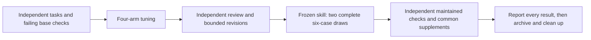

# Coding-session V3: smaller skill, unmet experiment goal

## Verdict

**The requested “less code without loss of completeness” result was not established.** The final skill produces lower combined physical source/test churn than main, PR #112 and Ponytail in both frozen final draws. Production churn is not consistently lower, generated snapshot bytes are larger, and independent checks expose correctness/integration omissions. This is an experimental refinement and a negative overall result, not a superiority claim.

The runtime skill is **2,642 bytes / 362 words / 17 lines**, versus main's **5,121 / 740 / 36** and PR #112's **3,161 / 422 / 21**: 48.4% and 16.4% fewer bytes. Only `skills/coding-session/SKILL.md` changes at runtime. Its pre-script, existing report and README are unchanged; this evidence is not another automatically loaded workflow.

## Design and Ponytail inspiration

V1 reported a smaller complete result; V2 did not reproduce an overall advantage. V3 therefore separated production, tests, bytes and correctness rather than optimizing a single total.

Ponytail's useful mechanism is an ordered decision process: find the first complete existing solution, prefer a readable expression, finish affected integrations, then stop. V3 adopts that economy rather than its persona, activation protocol, levels, answer format or a one-test quota. The final skill emphasizes composing existing operations, sharing results at their common lifetime, choosing the maintained test seam before writing tests, and tracing fixture consumers/generators. It retains safeguards, observable contracts, meaningful regressions and honest checks. It contains no benchmark-specific languages, repositories, examples or rules for winning an evaluator.

Ponytail upstream: <https://github.com/DietrichGebert/ponytail>, MIT, commit `84740e3d344b69b4a133201fa519eb37a62a2b2a`. Default/full skill SHA-256: `ba68ff26239c3c3b05b2a9a47ee0d9a6b93a69639a2555ec87a5d44bffaf2f0c`. Its source/profile is excluded from this evidence archive. Main is `92ec28467170bb8b520ebe53dea234b7623dec46`; [PR #112](https://github.com/LeonFelipeCordero/matato-pi/pull/112) is `36df53c5bb793a2029f69c2b28c622e73e8c7363`.

## Method and stopping rule

Three research subagents selected two new tasks per language and wrote independent behavioral checks before implementation. Each check fails on its pinned original source. One task per language was initially reserved. All tasks use existing projects under `~/workspace/projects`; original project source was not changed.

Produced **72 fresh Pi implementation processes**, each with one task/profile and its own detached worktree: 12 first tuning outputs, 12 second tuning outputs, and two complete 24-output final draws. Native subagent coordinators launched the isolated processes; 72 processes are not 72 native coordinator agents. Independent reviewers analyzed both tuning rounds and both final draws; a terminal reviewer applied the same supplementary probes across all final arms. A separate mutation attempt was blocked by missing Atlas support.

Every implementation requested Pi 1.2.0, `openai-codex/gpt-6.1-sol`, high reasoning, `read,bash,edit,write`, and a 900-second limit. Explicit skill text was appended as system instructions. Discovery of extensions, other skills, templates, context files and MCP was disabled; parent conversation history was absent. Every task received identical requirements/setup/check instructions across arms. Agents manually read target repository instructions. Dependencies were shared read-only by usage; no application/service deployment was required.

`plan.json` fixed at most **three candidate revisions**, then **two complete six-case draws** with no further revision, implementation repair or per-case selection. The success gate required complete behavior/maintained regressions, production **and** combined churn strictly below every baseline in **both** final draws, and a skill no larger than main or PR112. The final candidate was frozen before reserved implementations. Continued sampling until a favorable result would not establish the requested property; the failed gate remains visible.

Invocation/profile hashes establish configuration consistency, not audited tool-use history or causal isolation. Logs retain final agent summaries, not raw tool histories. An early reviewer accidentally saw the reserved TypeScript brief through an aggregate manifest; this is disclosed, not strict reviewer blindness. Research carryover, adaptive tuning, shared dependencies, concurrent load, one model and two draws remain confounders. The final draws ran concurrently, up to eight implementation processes at once. There is no statistical-significance or universal-superiority claim.

## Tasks and actual reuse

| Task | Local project / language | Contract and relevant facilities |
| --- | --- | --- |
| Unicode graph find | Atlas / Python | Unicode case folding, ranking, literal punctuation, exact stable keys, isolation and CLI; `str.casefold`, SQLite deterministic UDF, existing SQLAlchemy connection event/query composition |
| Literal database paths | Atlas / Python | Literal option-looking filenames across path sources, migration/writes/read-only access; SQLAlchemy `URL.create`, existing path resolution, transaction and migration facilities |
| Atomic memory references | Matato / TypeScript | Exact references, authoritative IDs, rollback/recovery, deduplication; existing transaction, stores, Maps, Sets and `mergeNumbers` |
| Confined session deletion | Matato / TypeScript | Lexical/canonical confinement, files/symlinks, recursive cycles and invalid children; Node path/fs primitives, existing traversal and managed-session path facilities |
| Quantity boundaries | Beer Game / Elixir | Nonnegative fields, form casting and partial updates; existing Ecto schemas/casting plus `validate_number` |
| Game vocabulary | Beer Game / Elixir | Supported values, explicit versus omitted state, accumulated errors; `validate_inclusion`, existing required checks and state casting with `empty_values: []` |

Pins: Atlas `835be1ac26bfb0b0003a01a741afed21bd550278`; Matato `4f2b75f73087b5f2c60995629c591dc91a591567`; Beer Game `141c8d40764677e3df348183491fdebe3f5ff3e4`.

Most substantive production reuse is **shared by all arms**. There is little honest size headroom in the identical Ecto changes or structured database-URL fix. Candidate memory implementations share the derived room-ID Set once outside the topic loop, rather than rebuilding it per topic. That is real lifetime-aware reuse but costs signature/call-site lines; no throughput or memory benefit was measured. Tuple/generator unpacking versus separate SQL-expression assignments is not a different algorithm or evidence of fewer SQLite evaluations.

## Revisions and rejected conclusions

| Draw | Cases per arm | Main prod / tests | PR112 prod / tests | Ponytail prod / tests | Candidate prod / tests |
| --- | ---: | ---: | ---: | ---: | ---: |
| First tuning | 3 | 60 / 577 | 63 / 621 | 66 / 625 | 58 / 629 |
| Second tuning | 3 | 60 / 594 | 63 / 648 | 60 / 592 | 61 / 647 |
| Frozen final one | 6 | 96 / 1,088 | 104 / 1,157 | 98 / 1,126 | 104 / 1,058 |
| Frozen final two | 6 | 98 / 1,112 | 132 / 1,217 | 104 / 1,130 | 105 / 1,026 |

Counts are added plus deleted physical lines, including comments/whitespace. Tests include fixtures, helpers and snapshots. No other churn is omitted. Three-case totals are not comparable with six-case totals.

CandidateOne (3,046 bytes) passed original checks but added an unregistered Python fixture; main missed dependent variant snapshots. Its apparent two-line production advantage over main was omitted blank separators. CandidateTwo (3,043 bytes) encouraged composition and fixture/case-table reuse but still lacked a regeneration route for a new snapshot and lost aggregate size gates. These outputs remain rejected, not repaired or replaced retroactively.

The same discovered existing Python fixture-consumer command was supplied to all later arms; frozen briefs and behavioral checks were not relaxed. CandidateThree (2,642 bytes) replaced checklist-like guidance with a shorter seam/gap decision process. Both final candidate Python fixture/generator integrations pass. That does not repair earlier outputs or prove other integrations complete.

## Final complete-draw results

| Draw | Arm | Production churn | Test churn | Combined churn | Added / deleted | Net lines | Byte growth |
| --- | --- | ---: | ---: | ---: | ---: | ---: | ---: |
| One | main | 96 | 1,088 | 1,184 | 1,150 / 34 | +1,116 | +83,294 |
| One | PR112 | 104 | 1,157 | 1,261 | 1,219 / 42 | +1,177 | +199,849 |
| One | Ponytail | 98 | 1,126 | 1,224 | 1,192 / 32 | +1,160 | +81,011 |
| One | candidate | 104 | 1,058 | 1,162 | 1,125 / 37 | +1,088 | +207,189 |
| Two | main | 98 | 1,112 | 1,210 | 1,179 / 31 | +1,148 | +64,577 |
| Two | PR112 | 132 | 1,217 | 1,349 | 1,303 / 46 | +1,257 | +66,851 |
| Two | Ponytail | 104 | 1,130 | 1,234 | 1,201 / 33 | +1,168 | +61,316 |
| Two | candidate | 105 | 1,026 | 1,131 | 1,097 / 34 | +1,063 | +197,027 |

Candidate combined churn is 1.9%/7.9%/5.1% below main/PR/Ponytail in draw one, and 6.5%/16.2%/8.3% below them in draw two. **Neither draw passes the production gate.** Candidate also loses individual cases: memory and quantities to every comparator in draw one; Unicode/memory to main and memory/quantities to Ponytail in draw two. No per-case best outputs are combined.

Physical lines are not semantic complexity or generated bytes. Removing blank lines narrows finalOne candidate/main combined churn from 1,162/1,184 to 1,068/1,072. One-line JSON snapshots hide megabytes: the candidate's existing shared fixture fans out into multiple snapshots, producing the largest byte growth in both final draws. All changed snapshots were fully parsed and their real generator routes exercised. Lower line totals are not a byte-size win.

## Correctness findings: frozen green was insufficient

All **48 final frozen acceptance** reruns, **48 original-native** reruns and **48 explicitly selected maintained-suite** runs pass. Reviewers also executed changed-source type/lint checks, fixture consumers and snapshot generators. Native selections did not cover every affected caller; Elixir native repeated the oracle, so new maintained ExUnit tests were loaded separately.

All twelve final candidate maintained suites detect original production in independent copies. Individual Ecto-file controls ensure an early failing loop does not hide missing validators. These are original-code controls, not proof of complete regression coverage or a mutation score.

A final reviewer froze common probes and applied them identically to every final arm, with original-base controls. Passing/selected tests:

| Draw / arm | Fixed-root symlink anchor | Persisted zero IDs | Existing work consumer |
| --- | ---: | ---: | ---: |
| One / main | 0/2 | 0/2 | 8/8 |
| One / PR112 | 2/2 | 2/2 | 7/8 |
| One / Ponytail | 2/2 | 2/2 | 7/8 |
| One / candidate | 0/2 | 0/2 | 8/8 |
| Two / main | 0/2 | 2/2 | 7/8 |
| Two / PR112 | 0/2 | 2/2 | 7/8 |
| Two / Ponytail | 0/2 | 2/2 | 8/8 |
| Two / candidate | 0/2 | 2/2 | 7/8 |
| Original | 0/2 | 0/2 | 8/8 |

**Symlink anchor:** resolving the managed root itself can move the allowed boundary outside the fixed lexical root. Failing outputs delete both an outside target and its referenced child through a stable root/ancestor symlink. The probe uses the brief's fixed-root interpretation; intentionally permitting root relocation would be a different product policy. No concurrent race or remote exploitability claim is made.

**Zero IDs:** finalOne candidate/main accept an explicit zero when a schema-valid persisted zero row exists, contrary to the brief's unconditional zero rule. Seed presence and five-table before/after state are asserted. Normal autoincrement creation need not generate zero for this boundary to be testable. All finalTwo arms reject it correctly.

**Work consumer:** failing outputs retain a fixture outside the newly narrowed managed root but still expect its deletion. The surviving file is correct confinement; the stale fixture is an integration omission. No safety guard or assertion was weakened to satisfy it.

Thus lower candidate session-test churn cannot all be credited to harmless setup reuse. Some missing coverage is meaningful. The supplemental checks remain separate from frozen acceptance; no original result is relabelled.

## Evidence, limitations and cleanup

`results.json` summarizes every retained draw and implementation. `evidence.tar.gz` contains all 72 whole patches, prompts/invocations/profile hashes, three candidate profiles, main/PR profiles, research briefs/oracles and negative controls, six review/probe records, command logs, metrics, freeze and integrity records. `evidence.sha256` verifies it; its internal member manifest checks every file. Ponytail source/profile, source worktrees, dependency binaries, credentials and raw chat sessions are excluded.

Extract to `/tmp/codingSessionV3`, inspect scripts before running, retrieve pinned repositories/Ponytail only if needed, recreate separate worktrees and dependencies, then apply whole patches. Drivers use recorded absolute paths and local environments: this is **not a hermetic benchmark**. Elixir tests used lock-matching Ecto 3.14.2, Decimal 3.2.0 and Telemetry 1.4.2 offline; provenance/hashes are retained, binaries are not bundled. Matato uses existing Bun/node_modules; Python uses the existing Atlas venv. Source transfer hashes and saved/live patch audits were verified before cleanup.

Initial harness capture failed after three completed Elixir outputs because Git rejected short exclude magic; those exact patches were retained and rechecked, with unavailable original agent exit/duration recorded null. Main's first coordinator invocation launched nothing due to an extra argument. Harness fixes and all subsequent executions are documented. Reviewer-local disk-quota/logging interruptions have retained traces and explicit rerun/unknown metadata; no implementation was resampled for them. Publication audit caught four initially omitted extensionless TypeScript launchers; packaging was corrected without changing their frozen bytes, and the original audit is retained.

Mutation adequacy is **blocked**, not passed: installed Atlas has no mutations command/catalog. Zero mutants selected/executed; no invented edits or score. Maintained baselines and fresh unsaved whole-project analyses passed but do not substitute for mutation evidence.

Focused checks are not full application coverage. Broader Python timeouts/performance-test failure and missing dashboard tooling remain unresolved, attributed limits. No full frontend, DB-backed Ecto, production-service, distributed, hardware, latency/RSS or exhaustive security experiment was performed. No measured resource saving, strict holdout blindness or general superiority is established.

Owned experiment worktrees and Ponytail checkout/profile are removed after preserving evidence. Cleanup also removes a legacy loose V1 Ponytail profile, not historical comparison results. Original target checkouts and pre-existing unrelated edits remain unchanged. `cleanup.json` records paths, verification and retained historical-evidence exclusions. The final skill is a smaller, explicitly experimental refinement; **the user's complete optimization target remains unmet**.
