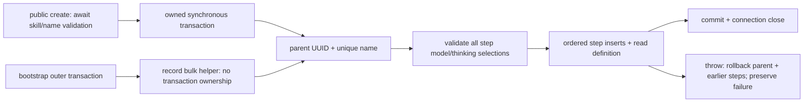

# Independent V4 finalOne review

**Verdict: NOT ESTABLISHED / production threshold missed on retained outputs; no valid complete paired draw.** V2 Python times out at the 900-second agent cap, despite acceptance passing. It remains invalidAgentRun, not a completed implementation. CandidateTwo's retained production is **39 additions / 58 churn versus Ponytail 33 / 50**, and **48 bytes larger**. Combined improvement (**713 / 767 versus 901 / 924**) cannot substitute for production, completion or quality. Candidate runtime **2630 bytes**, SHA256 `6efa072c53b7e83aae7a17f4f60a45efd113cd8dc927c1c1ebf815ec3cd25643`, satisfies the 2642-byte cap but is not qualified as a winner.

## Controls, scope and carried objections

Read reviewContract.md, plan.json, finalFreeze.json, historicalInspection.md, candidate decisions, all three prior reviews, four briefs/manifests, storage amendment, original report/runtime audits, all sixteen whole patches, changed production/tests and pinned-base counterparts, maintained instructions and affected callers. Reserve contents opened only after the recorded freeze; no broader strict analyst blindness claimed. No models, repairs, profile edits, dependency edits, schema changes, README edits, source cleanup, PR or implementation resampling. Parent's one predeclared second draw remains separate and unchanged; no third revision or favorable resampling is justified by this review.

Independently parsed all sixteen private raw streams without publishing them: complete exact profile first-read observed 16/16, identical same-case prompt hashes, sixteen distinct private configurations, requested/reported openai-codex/gpt-6.1-sol/high, fresh isolation flags and Pi1.1.0. Fifteen settled normally; V2 Python does not. Hidden backend response-model identity is not exposed. Original acceptance is **16/16 exit0**; original native is **10 exit0, six exit124** (Python and sequence under V3/V2/Ponytail). Those original results remain immutable, including the agent timeout. No acceptance pass supplies missing model completion.

Storage relocation is a disclosed uniform future-only change from earlier tuning: on-disk writable owned storage, same logical paths/read-only originals/dependencies and restricted network boundary. This is evidence of the storage mechanism, not proof that storage caused every timing result. Installed dependency/Pi versions are shared within V4, not a causal comparison with historical environments. V3 is merged28732233110979cc67c1f835c2995d42c6819a33, V2 is closed/unmerged PR112 at36df53c5bb793a2029f69c2b28c622e73e8c7363, and Ponytail is pinned default/full84740e3d344b69b4a133201fa519eb37a62a2b2a; per-case task bases are identical across arms. CandidateTwo is a composite adaptive rewrite after exposed tuning, not an isolated grammar/persona/clause experiment.

Prior objections remain: ablation established no reuse mechanism (TS identical, Python cosmetic); tuningOne candidate production26/38 versus Ponytail23/34 failed despite combined wins; snapshot-first compliance was deficient across non-Pony Python arms; native TS collection omitted added root-worker tests; Ponytail's prior native timing failure remains recorded; tuningTwo was quota-incomplete, never a valid comparison or recreated draw. Parent's responses—last candidate frozen before reserve access, no third revision, storage-only relocation, no repair/retry—are respected. This review does not retroactively repair prior scores. Longer native supplements are separately frozen and applied symmetrically to retained earlier tuning arms.

## Source, contracts and meaningful coverage

### Python discovery

All arms use pathlib strict final resolution, canonical-root containment and regular-file checks **before reading** ignore policy; missing/dangling/cyclic/directory paths supply no rules. Root Git mode uses the same eligibility predicate, retaining fallback exclusions for unusable root links. Existing pathspec GitIgnoreSpec remains the matcher. Rule-entry directory anchoring is separate from target-directory location; inherited rules are copied, Git/Atlas layers remain independent, and order/negation/pruning/non-traversed directory symlinks remain intact. Canonical analyzed-root aliases work through validate_repository. No concurrent-race policy was invented beyond the stable-filesystem brief.

V3/candidate return a resolved Path-or-None; V2/Ponytail return bool and read the eligible entry. These are equivalent under that brief. No new ignore engine, deleted boundary guard, or relocated production complexity found; root eligibility can be resolved twice, without measured performance significance. Candidate's extra Path/None/control-flow/comment bytes are not an established semantic efficiency benefit.

Traced `CLI index/report → analyze_folder → analyze_repository → validate_repository/discover_files`, and canonical-location saved-folder reuse. All add real behavioral external/local/external transitions, persisted exact file-node sets, in-memory report and saved index/report coverage, leaving source/external bytes untouched. V2 also covers nested CLI transitions; V3/candidate CLI transitions are root-only, with nested discovery tests. Existing circular-import assertions are preserved in their rewritten test. Ponytail preserves the old circular-import regression and adds a separate shared-coffee boundary/reanalysis route using an aliased root.

**Unresolved instruction gap:** Atlas AGENTS.md explicitly directs shared sample/snapshot-first regressions for indexing/report. V3/V2/candidate again add no snapshot assertions; shared sample bytes in inline temporary layouts do not fully satisfy that instruction. Meaningful behavior tests exist, but their lower size does not earn a clean instruction/completeness gate. This also remains applicable to earlier ablation/tuning partials already identified.

Ponytail adds `analysis.rules` (44B), `discovery.json` (678B, included/excluded path lists), `ignore_discovery_snapshot`, a maintained consumer and actual generator integration. Physical-source inventory now filters through real detect_language, correctly excluding the non-source rules file. Shared language/project inventories and extraction/analysis/graph/CLI/navigation/variant/safety routes remain coherent by source inspection. The snapshot asserts real path sets, not source strings or LOC. Its volume is fully counted; no hidden one-line JSON credit. Other arms change no fixture registry/snapshot/generator route.

### TypeScript pre-script lifetime

All reuse the existing FIFO mutex and nested finally boundaries. `return await module.run()` keeps the overlay and lock until settlement; `string | undefined` and explicit undefined comparison preserve absent versus present-empty values. Only supplied keys restore in Bun.env/process.env, while unrelated writes survive. Stat/import/run failures still release and propagate; shell dispatch remains outside the mutex with existing child overlay, cwd, STORAGE_PATH, JSON parsing and stderr/exit-code behavior. Scheduled-job/sequence wrappers retain their public APIs and environment construction.

V3/candidate production is byte-identical; V2/Ponytail is byte-identical, differing only by the PreviousScriptEnvironment alias. No algorithm/performance win inferred. All four new maintained suites meaningfully exercise asynchronous lifetime and overlap, sync throw/async rejection, restoration, failure/recovery, JSON results and independent shell execution. V2 additionally gates import failure/overlap and silent-exit handling; Ponytail covers more sync JSON shapes; candidate is not missing the central contracts. Dynamic fixture strings use Bun's actual Promise.withResolvers, unlike tuningTwo V3's unsupported maintained PromiseWithResolvers type. Current direct suites pass, rather than the old partial's stalled test being presumed fixed by fiat. Wrapper tests are unchanged/synchronous in this draw; shared-runner tests detect the bug, while wrapper integration remains less bug-specific than tuningOne V3/V2's changed async callers.

### TypeScript sequence creation

The actual ownership chain is:

V3/V2/candidate switch public creation to existing withStorageTransaction; Ponytail calls existing runInStorageTransaction around write on its opened connection, after duplicate-name check. Both reuse precisely the same begin-immediate/commit/rollback helper and synchronous result type, rather than compensation or a new transaction engine. Async filesystem validation stays outside; model selection and every write stay inside. A later model error previously left the already-written parent; a later trigger failure previously left parent/earlier steps. Rollback now covers both. Foreign keys and uniqueness remain enabled; no prevalidation-only workaround, swallowed failure, deletion of existing definitions or schema change.

Record-level createSequenceConfigs remains transaction-neutral, allowing bootstrap's single outer transaction over models/main config/jobs/multiple sequences. Existing transactional replacement is unchanged. Connection closure remains owned by withDatabaseConnection; no manual close/rollback/cleanup duplication introduced. Brief does not require arbitrary public calls inside caller-held transactions, failed rollback recovery, or changing record-helper ownership; none invented.

Identity remains crypto.randomUUID, read by immutable id or name; duplicate attempts leave existing identifiers, mode, timestamps/rows and ordering unchanged. stepOrder **0** is not treated as absent; list uses name ordering, steps use stepOrder rather than names. Empty drafts, totalWorks0, explicit null/omitted preScriptName mapping, delay null, booleans, thinking defaults and config's main-record sentinel retain their existing semantics. No unrelated historical zero-sentinel failure imputed here.

All own later missing/disabled/thinking selection and later insertion-trigger regressions with row snapshots and corrected same-name retries; duplicate and rich ordered metadata assertions are meaningful. V3/V2/Ponytail additionally own caller-transaction bulk rollback tests; candidate leaves bulk source unchanged and owns bootstrap late-insert rollback/retry plus existing bulk consumers. V2/Ponytail bootstrap tests cover both model-selection and insertion failure, V3/candidate insertion failure. Ponytail additionally owns a real Elysia app.handle POST failure/no-draft/retry/list/state/duplicate regression, without a listening server. Tests use existing storage fixtures, trigger cleanup in finally and fixture cleanup after each test, not production fakes that hide the failure. Differences in owned breadth explain some test-volume differences, not an automatic duplication claim.

### Bash bootstrap

All change only setup, use BASH_SOURCE/dirname/cd/pwd and quoted expansions, anchor manual_deps and all four launcher routes to the invoked repository, preserve installer ordering and selected-route fail-fast status. HOME/.local/bin mise is quoted. V3/Ponytail explicitly clear CDPATH during location resolution; V2/candidate do not. No symlink-resolution expansion, new dependency, replacement language or unrelated system policy was demanded. Candidate/V2 setup is byte-identical. Only supplied inert fake-command fixtures execute setup/manual_deps, never live home/dotfiles/installers/system configuration/network. The brief forbids maintained test-file changes, so this case has zero added owned regressions by design, not an unreported test-size win.

## Independent executions

Frozen behavior independently passes **all16** (Python8 tests, lifetime6, sequence8, Bash12 fixture cases per arm). Valid review native rechecks at the original120s cap yield **four Bash passes and twelve exit124**; initial Python mount errors are separately recorded below. The **separate240s diagnostic passes all12 current Python/lifetime/sequence copies**, not replacing any cap result. Sequence diagnostic durations154.973–157.342s and lifetime121.520–122.623s show why an outer whole-suite120s cap can truncate otherwise completing commands, not a reason to alter original scores.

Python current native diagnostics pass **219/233/233/219 tests**, respectively V3/V2/Ponytail/candidate, each plus78 subtests, and real navigation generator preserves **71/71/72/71 parsed snapshots**. Direct added lifetime suites pass **8/20/17/15**; direct changed/new sequence/config/API suites pass **11/13/14/10**. Changed-file TS lint passes all8 case/arm groups; native TypeScript checking includes new test types and passes in all current copies. Current lifetime existing consumers pass35/35 each; current sequence native consumers pass67/68/68/67 each, including replacement, empty drafts, bulk APIs, CLI, work/workLoop and bus. The symmetric actual existing API/server and agent-tools consumers pass **25/25 each** (no listening services).

Original-production controls use each arm's unchanged maintained tests/fixtures, not rewritten assertions: Python fails **8/20/12/8**, with **124/126/134/124** passes. Lifetime fails **8/10/17/13**, with **0/10/0/2** passes; V2 also emits two errors from original asynchronous rejection behavior, not missing dependencies. Sequence controls fail **4/4/5/4**, with **7/9/9/6** passes; Ponytail's fifth failure is its HTTP no-draft assertion. Bootstrap/caller-transaction controls can correctly pass original production because those contracts already worked. Bash original-production controls fail12/12 supplied relocated fixtures per arm, whereas all current original-native9-case fixtures pass. No maintained Bash test added, as required by its setup-only brief. These are original-production detection checks, not mutation scores.

Symmetric earlier supplements: all **nine retained Python arms** pass their longer native and real generator checks, preserving71 parsed outputs each except tuningOne Ponytail72. All **nine retained TS lifetime arms** receive one longer native invocation: ablation both exit0; tuningOne V3/V2/candidateOne exit1 and Ponytail exit0; tuningTwo V3 exit2, V2/Ponytail exit0. The new tuningOne failures are real retained observations: V3 bus `creates a failure when a message agent fails` hits its5000ms test deadline and incomplete-agent assertion; V2 `launches a message agent` and candidateOne `continues scheduling loop messages` hit5000ms deadlines, and both also fail unchanged loop-skip state assertions at bus.test.ts:1543, followed by background bootstrap-config errors after fixture teardown. This is not simply the old Ponytail failure relabeled. Identical production and previously documented5ms background waits support timing sensitivity under load, not a proven unique-profile cause. No tests/timeouts were patched and no failed assertion rerun. TuningTwo V3 reproduces its two TS2304 PromiseWithResolvers errors; its prior direct-test240s stall remains separately retained, not rerun until green.

There are **110 recorded isolated commands** spanning1035.894 seconds, maximum overlapping **8**, every outer budget≤240s. Twelve outer review timeouts are all at120s; no240s outer timeout. Earlier bus internal deadlines and original-production rejection errors remain in full logs. `allCommands.json`, `checkSummary.json`, `executionLimits.json` and per-command execution/stdout/stderr records distinguish every attempt, original-production control and supplemental diagnostic.

All writable checkouts/stages/HOME/TMP/XDG/logs are under `/home/leon/.cache/codingSessionV4Owned/reviews/finalOne`; `/tmp/codingSessionV4/reviews/finalOne` is only a logical symlink. Copies come from pinned git archives plus whole retained patches; changed bytes are verified against live outputs. Bubblewrap unshare-all, sanitized environments, read-only originals/dependencies/launchers, no credentials/services/network. Exact argv/environment, budgets, timings, full stdout/stderr and checksums are retained separately. No assertion-driven rerun until green.

Reviewer infrastructure errors retained: initial Python checks selected the interpreter's directory as oracle mount because the command begins with an environment assignment. Launchers could not open (exit2), not production failures. After all current checks finished, initial runner preparation also stopped because quota-failed tuningTwo has preserved partial patches under its review folder, not normal changes.patch artifacts; no earlier diagnostic had executed. The supplement uses those exact unchanged partial patches and verifies copied bytes against retained live outputs, never treating partials as completed runs. mountCorrectionPlan.json was frozen before explicitly selecting the correct oracle directory and running once symmetrically. Supplied launchers/tests/source were unchanged. Those failed review executions are retained, not silently replaced. Native TS still omits new root-worker and sequenceCreation tests; direct collection closes this review's evidence gap only, not the frozen launcher. sequenceRoutes.test.ts exists only as Ponytail's added file; absent paths in other arms are not counted as API coverage. The symmetric existing API/server + agent-tools consumer supplement uses actual existing paths.

Limits: focused maintained/native consumers and real Python generator, not blanket whole-repository lint/typecheck/dashboard/full Bun suite. Native wall time includes differing test workloads, fixture migrations/generation and host load; it is not an implementation-performance benchmark. Two service-requiring reminder tests remain excluded by the frozen native regex. No performance/stress/race study, exhaustive domain exploration or mutation score. Generator equality is parsed JSON, not formatting equality. Any stalled/timed-out suite remains incomplete even if earlier assertions pass. Private copies/runtime/raw configs are not publication artifacts; parent must review/secret-scan any selected logs before publication.

## Independent size accounting

Git no-index numstat plus exact bytes against pinned bases, including untracked test/helper/fixture/snapshot files. **Extensionless setup is production**, correcting the frozen suffix classifier symmetrically. Result bytes are entire changed files, not entire repositories; metrics.json also reports matched union-of-changed-path inventories and byte growth to avoid different unchanged-file-inventory comparisons. All totals are descriptive retained-output accounting, **not a valid completed paired score**.

| Case / arm | Production +/−/churn | Production result/growth B | Tests +/−/churn | Tests result/growth B |
|---|---:|---:|---:|---:|
| Python V3 |19/6/25|7169/413|98/5/103|11742/4041|
| Python V2 (invalid agent) |14/5/19|7105/349|121/36/157|11512/3811|
| Python Ponytail |15/5/20|7066/310|149/6/155|30387/6363|
| Python candidate |17/6/23|7173/417|107/35/142|10809/3108|
| Lifetime V3 |8/6/14|4719/61|270/0/270|8235/8235|
| Lifetime V2 |9/6/15|4760/102|345/0/345|10175/10175|
| Lifetime Ponytail |9/6/15|4760/102|269/0/269|8933/8933|
| Lifetime candidate |8/6/14|4719/61|290/0/290|8153/8153|
| Sequence V3 |6/2/8|7858/31|306/0/306|11949/8992|
| Sequence V2 |6/2/8|7858/31|313/0/313|12679/9722|
| Sequence Ponytail |1/1/2|7868/41|425/0/425|15997/13040|
| Sequence candidate |6/2/8|7858/31|277/0/277|10813/7856|
| Bash V3 |8/5/13|860/107|0/0/0|0/0|
| Bash V2 |8/5/13|875/122|0/0/0|0/0|
| Bash Ponytail |8/5/13|883/130|0/0/0|0/0|
| Bash candidate |8/5/13|875/122|0/0/0|0/0|

Only Ponytail Python adds fixtures **2/0/2,44B** and snapshots **23/0/23,678B**; all other fixture/snapshot deltas zero.

| Arm, descriptive four-case total | Production +/−/churn | Production result/growth B | Combined +/−/churn | Combined result/growth B |
|---|---:|---:|---:|---:|
| V3 |41/19/60|20606/612|715/24/739|52532/21880|
| V2 (incomplete) |37/18/55|20598/604|816/54/870|54964/24312|
| Ponytail |33/17/50|20577/583|901/23/924|76616/29641|
| candidate |39/19/58|20625/631|713/54/767|50400/19748|

Per-case candidate versus Ponytail: Python production loses **+2 additions/+3 churn/+107B**; lifetime wins **−1/−1/−41B**; sequence loses **+5/+6** but wins10B; Bash ties LOC and saves8B. Combined Python124/165 versus189/200 improves, lifetime298/304 versus278/284 **loses20 additions/churn** despite saving821B, sequence283/285 versus426/427 improves, Bash ties LOC. Aggregate combined saves9893 growth bytes, but production grows48B more; no overall qualified size win.

Sequence's raw LOC gap is primarily multiline import expansion for withStorageTransaction versus Ponytail's expression around existing write; both use the same transaction machinery, and candidate's resulting production is actually10B smaller there. Lifetime alias accounts for one production line/41B, not algorithmic efficiency. Python has small helper/branch/comment/wrapping differences, not measured reuse improvement. Bash's additional8B in Ponytail includes explicit CDPATH clearing, not hidden computation. Raw formatting must not be mistaken for a causal semantic improvement. Nonblank-stripped production churn **57/52/47/55**, respectively V3/V2/Ponytail/candidate; combined **704/815/876/711**. This diagnostic retains wrapping and is not a semantic-normalized benchmark; candidate's aggregate production loss persists.

## Remaining disposition

No production/correctness/completion winner established. Meaningful owned regressions exist, with the explicit snapshot-first gap and coverage breadth distinctions; production safeguards inspected here are preserved, not traded away for line counts. Original native/agent failures, prior timing and quota failures, incomplete comparison and all review diagnostics remain separate. Freeze remains2630bytes, unchanged. Parent may execute exactly the already-declared second draw for evidence, not to erase this draw or keep sampling until favorable. Final paired repetition, instruction gate and same-or-better production gate remain unresolved; retained numerical production threshold already misses Ponytail.
