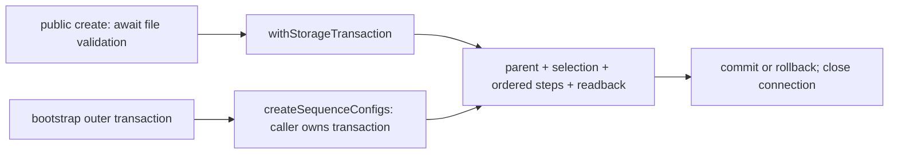

# Independent V4 finalTwo terminal review

**Terminal gate: NOT MET. Stop.** CandidateTwo production is **39 additions / 58 churn versus Ponytail 37 / 55**, with **144 more production bytes**. Combined **732 / 790 versus 862 / 886** is numerically smaller, not a substitute for production or quality. The frozen candidate remains **2630 bytes**, SHA256 `6efa072c53b7e83aae7a17f4f60a45efd113cd8dc927c1c1ebf815ec3cd25643`, within2642. No third revision, implementation draw, favorable replacement, PR or cleanup is recommended or performed.

## Both draws and prior objections

FinalOne is still incomplete: V2 Python hit the900s agent cap despite acceptance0. Its retained candidate production39/58 versus Ponytail33/50 and+48B already misses the numerical production threshold; combined713/767 versus901/924 cannot rescue it. Its six original native120s timeouts and separate240s passing current diagnostics remain distinct. FinalTwo completes all16 agents, but also misses production39/58 versus37/55. It neither repairs finalOne nor supplies two valid complete paired draws. No qualified overall size/quality winner, universal superiority, performance or persona conclusion follows.

Read reviewContract.md, plan.json, candidate decisions/finalFreeze, all four earlier reviews (ablationOne, tuningOne, tuningTwo, finalOne), four actual briefs/manifests, current report/runtime audits/handoff/storage records, all16 whole patches, actual changed files verified against reconstructed pinned-base copies, unchanged context, repository instructions and affected callers. Reserve content was read only after the recorded candidate freeze; no stronger analyst-blindness claim. No model/implementation launches, source/test/skill/frozen-launcher/README changes, repairs, dependency changes or cleanup.

The narrow ablation mechanism remains unestablished: TS identical and Python cosmetic. TuningOne production26/38 versus23/34 failed; combined did not rescue it. TuningTwo remains quota-incomplete with six partial processes, not a scored/recreated draw. Its V3 unsupported PromiseWithResolvers types/direct stalls and Ponytail failure remain retained. Earlier native bus internal deadlines/state failures remain observations, not erased by later diagnostics or established profile-specific causes. Parent responses—last composite candidate frozen before reserves, no third revision, future-only uniform disk relocation, exactly the predeclared second draw—were honored. `priorFindingsResponses.json` records findings, responses and unresolved objections explicitly.

## Independent controls and accounting validity

Independently parsed all16 private raw streams without publishing them: first tool successfully read the complete exact profile, requested/reported openai-codex/gpt-6.1-sol/high, fresh isolation flags, distinct private configurations, same-case prompt hashes and normal settlement. All agent and acceptance exits0. Original native is10 exit0 and6 exit124: Python and sequence under V3/V2/Ponytail. These are immutable120s results, not replaced by review supplements. Requested/reported identity is observable; hidden backend response-model identity is not exposed.

Independently confirmed **52 requested identities,50 actual invocation artifacts,51 ledger reservations: STOP**. All16 finalTwo runtime/profile observations match; no unused reservation justifies extra work. Coordinator max6 agents/trials is recorded. The parent interpreter spelling differs from finalOne (`python3` versus `python`), but both independently resolve to the same SHA256 binary `/usr/bin/python3.14`; all same-case arms within each draw match. Exact invocations remain retained.

V3 merged28732233110979cc67c1f835c2995d42c6819a33, V2 closed/unmerged PR112 at36df53c5bb793a2029f69c2b28c622e73e8c7363, Ponytail pinned default/full84740e3d344b69b4a133201fa519eb37a62a2b2a. Same per-case task base/setup/dependency access/checks/model/high/tools/caps. CandidateTwo is an adaptive composite wording change after exposed tuning, not a controlled individual-clause/grammar/persona intervention. Pi1.1.0/local installed dependencies are shared within V4, not causal comparators with historical versions.

The storage amendment applies uniformly only to future runs: disk-owned writable storage with logical `/tmp` symlinks, read-only originals/dependencies, same sandbox/network boundary. Earlier history preserved. The successful bounded allocation and filesystem headroom are evidence, not proof of unlimited effective Btrfs quota or a performance explanation. Review copies/stages/HOME/TMP/XDG/logs reside only under `/home/leon/.cache/codingSessionV4Owned/reviews/finalTwo`; `/tmp/codingSessionV4/reviews/finalTwo` is its logical symlink.

## Actual source, facilities, safeguards and owned coverage

### Python

All use pathlib strict final-target resolution, canonical-root containment and regular-file eligibility before policy reads. Missing/dangling/cyclic/directory-valued/external entries supply no rules; unusable root Git policy retains fallback mode. Existing pathspec GitIgnoreSpec still owns matching. Entry-directory anchoring, copied inherited rules, independent Git/Atlas layers, order/negation/parent pruning and non-traversed directory symlinks remain intact. Aliased analyzed roots canonicalize in validate_repository. The stable-filesystem brief does not demand new concurrent-race machinery.

Ponytail returns a boolean and reads the eligible entry; others return Path-or-None and read the target. Both preserve the stated contract. V3 loads/reuses root Git rules, whereas V2/candidate resolve root eligibility and later load again. No measured efficiency benefit, new ignore engine, deleted boundary guard or relocated production complexity. Canonical-root context parameters are required policy context, not speculative cheap-work hoisting.

Traced CLI index/report → analyze_folder → analyze_repository → validate_repository/discover_files, plus canonical-location save_folder reuse. All maintained reanalysis tests preserve circular-import removal/restoration and exercise external→local→external rules, in-memory report, index/saved report, exact persisted file sets and unchanged source/external policy bytes. Candidate now covers root AND nested CLI transitions, unlike its first final draw; V3/V2/Ponytail use root CLI transitions with nested discovery coverage. Discovery tests distinguish regular internal chains, aliases, entry anchoring, fallback and inherited rules; candidate also explicitly owns directory-link and undecodable-external-policy cases.

**Snapshot-first gap remains in V3/V2/candidate.** Atlas AGENTS.md expressly prefers shared sample/snapshot regressions for indexing/report. Those three again add no snapshot assertions; meaningful inline discovery/CLI behavior coverage is not full compliance. Ponytail extends the existing coffee pipeline seam: copies the real Python sample, overlays unusable root/nested links through an aliased root, and compares actual analyze_repository graph and unsaved report JSON to existing graph/CLI snapshots, also asserting no database creation. This is maintained behavioral snapshot reuse, not source/LOC checking; expected output need not change when rejected policy should leave the graph unchanged.

No arm changes fixture files, sample registry, snapshots or generator code in this draw. Independent physical fixture/snapshot inventory matches the base in all4 arms (417 files), unlike Ponytail's new fixture/snapshot volumes in earlier rounds. Traced LANGUAGES/standalone inventories, physical-source seam assertions, coffee_sources, extraction/analysis/graph/report/check CLI generation, navigation and variants. The real update_coffee_snapshots --navigation route is exercised separately, comparing parsed output, never generating repaired expected baselines into retained outputs.

### TypeScript lifetime

All retain the existing FIFO mutex and nested finally ownership. `return await module.run()` holds overlay and lock through final settlement while preserving rejection. Undefined is stored separately from present-empty and restored with explicit undefined comparison in both environment views; only supplied keys restore. Stat/import/run failure still restores/releases and allows recovery. Shell dispatch stays outside the lock, retaining child overlay/cwd/STORAGE_PATH/JSON/error behavior. Scheduled and sequence-step APIs/environment construction are unchanged.

V3/V2 production is byte-identical; candidate/Ponytail use Object.fromEntries for the previous values, with one extra annotation/wrapping in Ponytail. These are native object/Promise facilities plus existing project synchronization, not a new framework or measured optimization. No synchronization/cleanup safeguard removed.

All added direct suites meaningfully test async lifetime/overlap, sync throw/async rejection, exact absent/empty/nonempty restoration, import/missing-file failure/recovery, rejection identity, unrelated writes, JSON shapes and independent shell execution. V3/V2/candidate additionally make actual wrapper tests read environment after awaiting; Ponytail's wrappers remain unchanged, while its direct suite covers more sync/async JSON combinations and gated import failure. A larger matrix is not automatically duplication, nor a smaller suite proof of equal breadth. Current V3 uses Bun-compatible ReturnType/Promise.withResolvers, not the unsupported maintained PromiseWithResolvers type in tuningTwo's retained partial.

### Sequence

All4 production patches are **byte-identical**: public create now calls existing withStorageTransaction. Async skill/name validation stays outside; duplicate check, parent UUID insert, model/thinking validation, ordered steps and readback stay inside the existing synchronous begin-immediate/commit/rollback owner. A later selection error rolls back the already-written parent; a later insertion error rolls back parent and earlier steps. Original errors propagate and connection closure stays with withDatabaseConnection. No compensating deletion, swallowed failure, new transaction engine, schema change or weakened foreign-key/model policy.

Record-level bulk remains transaction-neutral for bootstrap's outer all-or-nothing models/main config/jobs/multiple-sequences transaction. Existing transactional replacement is untouched. UUID/name lookup, name-sorted lists, stepOrder0 and input order, omitted pre-script→null, thinking defaults, false/true flags, delay null, empty drafts and totalWorks0 retain semantics. Actual API routes, CLI, existing server/agent-tools, work/workLoop and bus consumers are included in inspection/check scope, not inferred from the public oracle alone.

All own later missing/disabled/thinking failures plus later database failure, row equality/no-parent checks and corrected same-name retry with identity/metadata/duplicate assertions. V3 uses the real uniqueness constraint as its owned write-failure path rather than a new trigger; frozen oracle tests independently cover trigger failure equally. V2/Ponytail/candidate own trigger paths. All add bootstrap rollback/retry across all tables; V3/Ponytail use later duplicate insertion, V2/candidate use a later-step trigger. V2/Ponytail additionally own bulk-caller rollback; candidate/V3 retain unchanged bulk API and its existing consumers. Ponytail also owns actual API app.handle and CLI failure/retry regressions, no listening server. These are real coverage breadth differences explaining much of its larger test output; candidate's lower total is not automatically a substantive efficiency win or proof of missing correctness.

### Bash

Only setup changes in all4 arms, as required. All use Bash script location and quoted arguments; manual_deps executes once after changing to the invoked repository, and all4 launcher routes receive that absolute source as one argument. Installer ordering and selected-route/dependency fail-fast remain intact; HOME/.local/bin mise is quoted. Candidate uses `cd` then `$PWD`, others subshell `cd`/`pwd`; V2 explicitly clears CDPATH. No extra symlink-resolution/system requirement invented. `manual_deps` is inspected but never changed or run live. Frozen nested Bubblewrap fixtures use inert fake commands and a synthetic home, not live configs/installers/network. No maintained test additions are permitted by the setup-only brief; zero tests here is required, not hidden coverage reduction.

## Independent checks

Frozen behavioral checks independently pass all16: Python8, lifetime6, sequence8 tests and Bash12 inert fixture cases per arm. Scoped native at the original120s cap yields four Bash passes and twelve timeouts; original coordinator results remain separately10pass/6timeout. The predeclared separate240s diagnostic passes all12 current Python/lifetime/sequence copies, with no240s timeout or failed current assertion retried.

Python native passes **217/227/227/229 tests**, respectively V3/V2/Ponytail/candidate, each plus78 subtests; actual navigation generator preserves all71 parsed snapshots in every arm. Lifetime native passes35 existing consumers each; direct added shared-runner suites pass18/16/31/10, plus all changed bus/scheduled wrapper tests (including V2's extra async integration). Sequence native passes67 existing consumers each; direct changed/new maintained groups pass10/13/17/9. Actual existing API/server and agent-tools consumers pass25/25 per sequence arm. All8 changed-TS-file lint groups pass; native TypeScript checks include the new maintained test types and pass.

Original-production controls use each arm's unchanged owned test/fixture bytes, never repaired assertions. Python fails8/12/16/16 with122/128/124/126 passing. Lifetime changed groups fail20/15/29/10 with5/9/2/7 passing; V3/V2/candidate each also fail their changed async scheduled wrapper, and their bus wrapper is collected independently of that test. Sequence controls fail4/5/7/4 with6/8/10/5 passing; Ponytail's additional failures include actual API and CLI no-parent/retry assertions. Bootstrap and caller-transaction tests can correctly pass original production because those contracts already worked. Bash original production fails12/12 relocated inert cases each; current native9/9 cases pass. Failures are actual boundary/lifetime/rollback/path-set assertions (including original external-policy Unicode errors), not absent dependencies. These are meaningful original-production detection controls, not mutation scores.

There are **86 completed isolated execution records**:55 exit0,19 expected original-production exit1,12 native120s exit124. Maximum recorded overlap8; known check span690.294s. Eight initial native invocations interrupted for collection correction are additional incomplete attempts, not silently counted as passes. Full argv/environment/timeouts/timings/stdout/stderr are in allCommands.json, checkSummary.json, executionLimits.json and logs; collectionInterruption.json retains interrupted process argv. Current diagnostic durations113.694–184.412s are workload/load observations, not implementation-performance measurements.

supplementPlan.json was frozen before checks; collectionPlan.json records the pre-collection scope correction. Initial eight Python/lifetime behavior checks completed; initial eight native invocations were interrupted before direct collection after inspection identified two unchanged Bun.serve reminder tests in a changed file. No assertion failure was observed before interruption. Logs/process argv remain retained; those interrupted runs are incomplete, never exit0. Resumed scoped native commands have separate labels, original120s caps, and all changed tests remain included. Only the two unchanged service-listening tests are uniformly excluded, as in previous native scope. No assertion/source/launcher was modified or failed assertion rerun until green. These reviewer infrastructure interruptions are not attributed to production.

Commands use exact git-archive bases plus entire whole patches; every changed byte, including untracked tests, matches live output. Existing Bubblewrap unshare-all supplies sanitized environments, read-only originals/dependencies/oracles, no credentials/services/network and only owned writable disk paths. No new clarified behavioral requirement was introduced; finalOne's earlier symmetric240s diagnostics and original-production controls remain sufficient for unchanged probes and were not repeated. All original results and earlier failures stay authoritative. finalIntegrity.json independently matches all649 initial input hashes and all live/owned changed-file hashes. knownEvidenceVerification.json additionally matches73 frozen inputs,6 executables,1184 original files,464 recorded run artifacts and99 scoped prior-review artifacts against parent inventories. An attempted full58357-file historical rehash exceeded a separate120s terminal budget before completing; no full-history pass is claimed, and that ancillary timeout is not a behavioral result.

Limits: focused native/maintained/affected consumers plus real generator, not blanket full-repository Python typing/lint/dashboard or all Bun tests. Service-requiring reminder tests excluded; no full Atlas self-analysis. Parsed snapshot equality is not formatting equality. Timeouts leave incomplete coverage even if preceding assertions passed. No performance/stress/race/exhaustive-filesystem study or mutation score. Runtime timings combine different test workloads, migrations/generation and host load; never implementation performance rankings. Parent must independently select/secret-scan publication artifacts; private copies/runtime/config/raw streams are not public evidence.

## Independent metrics

Git no-index numstat and exact full-file bytes against pinned bases, including untracked tests; stripped-nonblank line comparison separately. **Extensionless setup is production equally**, unlike frozen suffix classifier's other. Frozen raw metrics remain verbatim in frozenMetrics.json and original run artifacts. Result bytes below mean entire changed files, not repository size. Matched union-of-changed-path inventory neutralizes different unchanged-file contexts; byte growth supplies the same comparison without inventory bias. Fixtures/snapshots have zero deltas in every arm in this draw.

| Case / arm | Production +/−/churn | Production result/growth B | Tests +/−/churn | Tests result/growth B |
|---|---:|---:|---:|---:|
| Python V3 |18/7/25|7301/545|112/35/147|13676/3425|
| Python V2 |18/6/24|7239/483|112/37/149|13643/3392|
| Python Ponytail |13/5/18|7044/288|109/6/115|19945/4694|
| Python candidate |16/6/22|7257/501|123/36/159|14259/4008|
| Lifetime V3 |9/6/15|4760/102|273/5/278|20859/8794|
| Lifetime V2 |9/6/15|4760/102|332/2/334|21496/9431|
| Lifetime Ponytail |10/6/16|4769/111|275/0/275|8091/8091|
| Lifetime candidate |9/6/15|4725/67|304/3/307|21428/9363|
| Sequence V3 |6/2/8|7858/31|274/0/274|11013/8056|
| Sequence V2 |6/2/8|7858/31|322/0/322|12322/9365|
| Sequence Ponytail |6/2/8|7858/31|441/0/441|16742/13785|
| Sequence candidate |6/2/8|7858/31|266/0/266|10732/7775|
| Bash V3 |8/5/13|873/120|0/0/0|0/0|
| Bash V2 |8/5/13|883/130|0/0/0|0/0|
| Bash Ponytail |8/5/13|875/122|0/0/0|0/0|
| Bash candidate |8/5/13|850/97|0/0/0|0/0|

| Arm | Production +/−/churn | Production result/growth B | Combined +/−/churn | Combined changed-file result/growth B |
|---|---:|---:|---:|---:|
| V3 |41/20/61|20792/798|700/60/760|66340/21073|
| V2 |41/19/60|20740/746|807/58/865|68201/22934|
| Ponytail |37/18/55|20546/552|862/24/886|65324/27122|
| candidate |39/19/58|20690/696|732/58/790|67109/21842|

Matched combined result bytes are **73890/75751/79939/74659**, V3/V2/Ponytail/candidate (matched base52817). Candidate saves5280 combined bytes but adds144 production bytes. Its larger unmatched changed-file result67109 versus65324 is not contradictory: candidate also changes existing wrapper files whose unchanged context Ponytail omits from that inventory. No qualified overall size win when production worsens.

Candidate versus Ponytail per case: Python production **+3 additions/+4 churn/+213B**; lifetime **−1/−1/−44B**; sequence identical; Bash LOC ties,−25B. Combined Python **+17/+48** loses despite−473 growth B; lifetime **+28/+31/+1228B** loses; sequence **−175/−175/−6010B** improves; Bash LOC ties. Aggregate combined savings are concentrated in sequence's narrower owned coverage, not new production economy.

Production differences are chiefly helper return/control flow, docstrings/comments and wrapping; sequence exact identity establishes no different implementation mechanism. Candidate uses shorter Bash expression, not different behavior in the required stable fixture domain. Lifetime Object.fromEntries is native but not measured faster. Nonblank-stripped production churn **58/57/52/55**, combined **711/808/832/742**. Candidate's production loss persists; stripped lines still retain wrapping, not semantic normalization. No substantive credit for guard/comment deletion, missing regressions, compressed JSON, cosmetic formatting or relocated complexity, and no intentional gaming inferred.

## Terminal disposition

Production gate fails in both retained final outputs; finalOne also lacks a complete paired model run. Runtime cap passes, combined counts improve, meaningful owned regressions exist, and inspected production safeguards are preserved. Snapshot-first instruction compliance remains unresolved in candidate Python, native reliability/coverage stays qualified by retained timeouts/failures and focused limits. **Original owner objective not established. Stop at51 reservations/50 actual processes/52 requested identities.** Parent publication audit remains independent; nothing here authorizes further implementation, source repair, favorable resampling or a winner claim.
