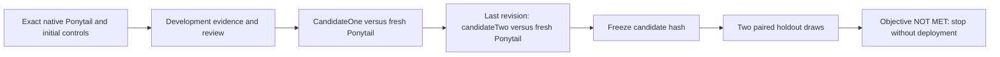

# V5 final evaluation

## Decision: objective NOT MET

The user requested exact Ponytail first, then procedural improvements until every metric wins. V5 did not achieve that objective. Neither candidate qualifies. There is no winning deployment. The study stops at its frozen two-revision limit; it does not relabel a partial improvement as success or continue tuning on exposed holdout evidence.

Strict all-metric superiority requires every directional metric to improve, with all correctness, completion and safeguard gates satisfied. Ties are not strict wins. A baseline already at maximum measured correctness cannot be strictly beaten on that score. A bounded Pareto improvement instead permits ties, requires no regression and at least one improvement. These are different objectives. Neither aggregates nor this small sample establish a universal claim.

## Protocol and accounting

`plan.json`, both decision files, `finalFreeze.json`, `amendments.md` and the archived `cases/amendments.md` define the protocol and deviations. There were **26 launch attempts: 25 actual implementation generations, 20 valid completions and 5 invalid Python generations**, plus one pre-provider infrastructure failure. All 25 actual generations passed their captured acceptance and focused/native checks. This does not mean all 25 passed quality or completion gates.

| Stage | Actual generations | Valid / invalid | Interpretation |
|---|---:|---:|---|
| Initial three arms × three development cases | 9 | 6 / 3 | Every Python generation hit 600 seconds. |
| RevisionOne: candidateOne and fresh Ponytail | 6 | 6 / 0 | Completed, but mixed resources and quality findings. |
| RevisionTwo: candidateTwo and fresh Ponytail | 6 | 4 / 2 | Both Python generations hit 600 seconds. |
| Frozen holdout: two paired draws | 4 | 4 / 0 | Behavior passes; resources mixed; size debt worsens. |
| Earlier infrastructure launch | Not a generation | Not a completion | Auth/settings lock creation failed before any observed provider request. |

The failed infrastructure launch remains in `results.json` and the ledger. It had no assistant messages or tool calls. Its failing original acceptance is not a failed implemented fix, and absent model usage is not a free successful run. The documented mount amendment made isolated lock directories writable while protecting credential/settings files. No implementation failure was repaired or resampled.

All implementation arms used Pi 1.2.0, `openai-codex/gpt-6.1-sol`, high thinking, the same four tools, fresh pinned clones, native full mode and a 600-second agent cap. Harness commands had separate 120-second limits. The briefs' intended 900 seconds did not override the enforced cap. Orders were interleaved as frozen; they were not a large randomized trial.

Exactly two candidate revisions were used. CandidateTwo was frozen at SHA-256 `da4417ae2056ad54ea7a4e287d71f5ac0e5386b3c064f877a5df3dbdc58485d9` before holdout exposure. Holdout preparation was separate from development prompts. No tuning followed exposure.

## Results, not a winning aggregate

Values below are **sums across each stage's attempts**, including invalid generations. Seconds sum agent durations; they are not elapsed study time under concurrency. Production churn is additions plus deletions, including the semantically classified extensionless installer. Costs are Pi-reported USD, not invoices.

| Stage / arm | Production churn | Agent seconds | Pi USD | Total tokens | Turns / tools |
|---|---:|---:|---:|---:|---:|
| Initial exact Ponytail | 27 | 835.174 | 0.5636064 | 1,121,644 | 45 / 82 |
| Initial narrative twin | 28 | 822.739 | 0.5473240 | 1,074,462 | 50 / 86 |
| Initial legacyNative | 30 | 855.022 | 0.5545708 | 1,281,523 | 51 / 92 |
| RevisionOne candidateOne | 28 | 794.722 | 0.5570324 | 1,324,253 | 59 / 95 |
| RevisionOne exact Ponytail | 29 | 840.794 | 0.5633712 | 1,091,908 | 49 / 88 |
| RevisionTwo candidateTwo | 30 | 851.842 | 0.6004776 | 1,176,610 | 55 / 108 |
| RevisionTwo exact Ponytail | 29 | 769.491 | 0.4634216 | 788,674 | 43 / 75 |
| Holdout candidateTwo | 25 | 314.825 | 0.2545260 | 387,339 | 30 / 59 |
| Holdout exact Ponytail | 25 | 246.833 | 0.2627460 | 309,625 | 27 / 45 |

CandidateOne reduced aggregate churn, time and reported cost, but increased tokens, turns and tools. Per-case trade-offs remain: its Bash cost and Python cost exceed their fresh baselines, and its TypeScript total tokens increase. Its Bash production ties exactly. The fresh baseline also has quality failures; beating a defective baseline on selected resources is not a clean all-metric result.

CandidateTwo loses the development aggregate on every resource column above and has an invalid Python completion. Its completed TypeScript fix ties production but takes 151.532 versus 67.884 seconds and costs 0.1768620 versus 0.1017908 USD. Bash production ties; candidate cost improves while tokens, turns and tools increase.

| Holdout draw, candidateTwo / Ponytail | Production churn | Seconds | Pi USD | Total tokens |
|---|---:|---:|---:|---:|
| One | 12 / 12 | 132.912 / 104.793 | 0.0997412 / 0.1082660 | 125,085 / 152,289 |
| Two | 13 / 13 | 181.913 / 142.040 | 0.1547848 / 0.1544800 | 262,254 / 157,336 |

The holdout aggregate saves reported cost but ties churn and uses more time and tokens. It is not a consistent win or a bounded all-resource Pareto improvement.

### Size and measurement boundaries

The JSON reports retain additions, deletions, bytes, growth, files, physical/nonblank/comment-prefix-code LOC, and level-9 raw-DEFLATE added-source bytes. They also separate tests, fixtures, snapshots and combined delivery. These are not interchangeable with upstream whole-file LOC or gzip metrics.

| Comparison, candidate / Ponytail | Test + fixture churn | Snapshot churn | Combined churn | Combined added bytes | Sum of per-run combined raw-DEFLATE bytes |
|---|---:|---:|---:|---:|---:|
| RevisionOne | 323 / 355 | 2 / 2 | 353 / 386 | 146,872 / 302,394 | 12,840 / 15,078 |
| RevisionTwo | 307 / 322 | 10 / 2 | 347 / 353 | 398,453 / 121,145 | 27,869 / 10,811 |
| Holdout | 275 / 246 | 0 / 0 | 302 / 273 | 8,831 / 8,245 | 2,310 / 2,136 |

One-line snapshot rewrites can dominate bytes while barely affecting line churn. Smaller tests do not establish better coverage. LOC describes changed files, not the whole repository. Raw captures classify `manual_deps` as other; derived reports explicitly restore its production classification. Fixture folder names also affect raw categories. Captures were not rewritten.

Every TypeScript patch includes the setup-created absolute `node_modules` symlink. It is not authored functionality and must not ship. The reporter excludes it from derived workspace-root delivery, but its holdout combined totals still include one line, 52 bytes and one file per run. Historical raw totals remain intact. Production totals do not include that link.

## Behavioral and quality evidence

The three development tasks cover Git checkout-root identity, bounded distinct-edge traversal and installer failure propagation. The holdout covers scheduler callback ownership. Independent quality reviews inspected all 25 implementation patches. Maintained tests reject original production with the final tests retained. Bash behavior tests were explicitly discovered and executed without skips; `bash -n` alone is only syntax coverage. Installer execution used inert command doubles and isolation, not a live installation. Darwin was simulated on Linux.

`reviews/initialQuality.md` records required Atlas policy failures in all three initial Python patches and a 130-line narrative-twin TypeScript suite callback. `reviews/revisionOneQuality.md` records clean required Python policy for candidateOne, but five new baseline Python violations and a 108-line baseline TypeScript callback. Required full importer/dashboard closure remained incomplete.

`reviews/finalQuality.md` and `reviews/gateResults.json` record both final Python timeouts, two required baseline Python policy violations, and clean candidateTwo Python policy on independent rerun. That rerun cannot complete an interrupted generation. All four holdout test-suite callbacks enlarge an inherited 101-line violation to 162–241 lines. Newly added individual tests stay below 100 lines; under a strict changed-function interpretation, the enlarged containers still fail. No changed code file reaches 600 lines. Advisory complexity findings in Bash support/tests are disclosed separately from required repository policy.

Relevant maintained, acceptance, type and lint checks pass. Full importer runs remain unfinished; dashboard build/test/type/lint closure is blocked by missing offline dependencies/tools. Passing shards overlap and must not be added as separate coverage. Reviewed navigation snapshots preserve existing responses; this structural review is separate from the blinded grader, which did not receive snapshot bytes. Production changes stay at existing owners without new dependencies or unrelated redesign. Reviewer scheduler supplements pass all four holdout patches, but they are not delivered tests or frozen mutation results.

## Presentation, blind review and mutation limits

The Ponytail narrative twin preserves words, order, persona, metadata and native mechanism while removing list markers and joining section text. On three initial cases it shows no consistent advantage: both Python runs are invalid; Bash tokens decrease but cost increases; TypeScript cost decreases but tokens and churn increase. `legacyNative` adapts the existing narrative body to the same native metadata. It does not reproduce the live skill's production invocation. Candidate revisions are composite procedural changes, not isolated linguistic causes.

The single same-model blinded grader reviewed 16 cells, not all 25 generations. It scored overengineering 0 for all, completeness 3 for 12 completed cells and 2 for four invalid cells. Completed replies tie at accuracy/clarity 3; coverage is 3 for eleven and 2 for one. Invalid final-reply scores are null, not scores for progress text. These coarse ties do not establish equivalence, universal quality or superiority and do not override independent policy/size findings. The verbosity control described a repetitive 250-word reply; it did not supply that reply. This is weaker calibration than a concrete control. There was no independent judge provider, upstream Sonnet-equivalent judging, pairwise preference experiment, same-code reply experiment or significance analysis.

`reviews/mutationSummary.md` and `reviews/mutations.json` cover **revisionOne only**. Four catalog-issued mutants were executed in isolation: candidateOne 2/2 assertion kills; exact Ponytail 2/2. All four baselines passed. There were no executed survivors, invalid mutants or timeouts. Of 815 generated manifests, 811 were unselected; two recognized relevant alternatives were not executed. Bash lacked a supported catalog mapping. Existing tests also kill the selected operators. This is a small selected tie, not exhaustive coverage or isolated added-test value. **CandidateTwo and its holdout patches were not mutation-tested. Do not borrow candidateOne's score.**

## Exact source and native activation

Ponytail 5.2.0 is pinned to upstream commit `84740e3d344b69b4a133201fa519eb37a62a2b2a`; its original skill hash is `ba68ff26239c3c3b05b2a9a47ee0d9a6b93a69639a2555ec87a5d44bffaf2f0c`. Original native extension, hooks, shipped scripts, skills, retained metric definitions and MIT notice are preserved byte-exact. The current `baseline/provenance.json` inventories **49 upstream files**, not 50; counting the separate study observer gives 50 files, not 50 original upstream resources. The manifest is authoritative. This is the native Pi closure and documented source subset, not the complete cross-host distribution.

Valid runtime activation audits observe the transformed full-mode section at actual Pi pre-start/context boundaries. That is stronger than the offline factory mock alone. It is not provider-wire identity, remote receipt or semantic-compliance proof. Final Ponytail Python has a failed activation count correspondence: 24 contexts versus 23 assistant messages, despite matching observed hashes. Activation validity also does not cure a completion timeout.

Native Pi does not execute Claude Code's map/statusline/subagent machinery. V5 enables Bash/testing, unlike the original headline NO_RUN/no-Bash experiment. It does not reproduce that benchmark. `baseline/integration.md` inventories every original metric and its Pi mapping. Original planted-review/outside-diff recall fixtures, historical robustness/build instruments and the original test-necessity/mutation matrix are missing or unavailable at this pin. Their scores were not measured here. Local judge scores and selected mutations are explicitly separate instruments, not replacements for those missing original results.

## Cost, drift and deployment

The 25 implementation generations report **4.367076 USD and 8,556,038 tokens** in total. This excludes coordinators and reviewers. Interrupted calls may have unreported usage; actual billing is unknown. Finalized assistant-message accounting includes input/output/cache components once; reasoning is already part of output. Cache-write is zero where reported. Missing backend identity, permission-denial and billing fields remain unavailable, not fabricated zeros.

`environmentDrift.json` records external main-repository HEAD advancement from case commit `7754bba086197ba0acce343dc62c560e6fcede0d` to `0ead6bdcec3f53342b3ccb5718e3b2824ba86df1`. Trials still use the pinned case commit. Toolchain drift includes Node 25.9.0 to 26.12.0 and host Bun 1.4.3; acceptance uses Bun 1.3.11. Final review repeated TypeScript candidate/control checks with that pin. The sandbox lock amendment is the disclosed infrastructure hash difference. No external changes were reset or concealed.

The live skill remains SHA-256 `6efa072c53b7e83aae7a17f4f60a45efd113cd8dc927c1c1ebf815ec3cd25643`. No candidate was deployed. No dependencies, live scripts, issue-assignment run or global settings were changed by the terminal decision. No winning deployment is authorized.

## Evidence packaging and root validation

The final packaging contract is `archives/sources.tar.gz` for raw baseline/case/script sources and `archives/evidence.tar.gz` for public run, review, mutation and blinded evidence. Metadata, profiles and reports remain directly available. After verified archival, raw sources leave the discoverable `extras/` tree to prevent Bun/lint discovery. Paths to those sources in historical reports refer to archive members, not missing required runtime files. Absolute cache paths are historical locators; use the packaging inventory for archived evidence. See `replay.md`.

`validation.json` records the final repository-root commands, exits, archive verification and remaining failures or exclusions. Repository checks are separate from experimental correctness and completion. The study decision remains objective NOT MET regardless of packaging validation.
