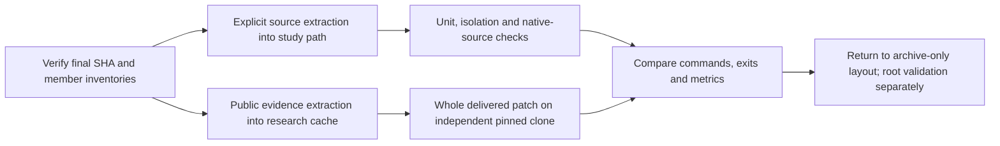

# V5 evidence replay

## Scope and archive boundary

This guide supports **offline research verification**, not another optimization round. The objective was NOT MET. Do not tune profiles, resample failures, call models, deploy a candidate, change global settings, run issue assignment, install dependencies or commit replay artifacts.

Final packaging places raw baseline/case/script sources in `archives/sources.tar.gz` and public run/review/mutation/blinded evidence in `archives/evidence.tar.gz`. Metadata, profiles and reports remain directly available. Source paths such as `scripts/runTrial.py`, `cases/workspaceRoots/acceptance.test.ts` and `baseline/upstream/pi-extension/index.js` below are **archived source paths, available after explicit extraction**, not required loose application files. Historical absolute cache links identify original locations; resolve their archive counterparts through the final packaging inventory.

The packaging step removes raw sources from the discoverable `extras/` tree only after archive verification. This prevents repository-wide Bun/lint discovery of research fixtures and vendored tests. Do not unpack them for routine application tests. Extract sources into `extras/codingSessionV5` only for explicit research, then restore the archive-only layout before root validation. Do not restore research files into application `src/`, `worker/`, live skills or global configuration.

No credentials, private raw streams, provider thinking, private failure details, full dependency trees or complete run workspaces belong in the public archives. Do not publish cache parents or private directories to make replay easier. Public traces are sanitized evidence, not complete raw provider transcripts. Pattern scrubbing is not a universal secret detector.



## 1. Verify before extraction

Read the parent packaging step's `validation.json` and its referenced SHA/member manifests. Verify both archive SHA-256 values against those records before extraction. Inspect member paths, modes, byte counts and per-file hashes. Reject unexpected absolute paths, parent traversal, private/auth contents or destinations outside the declared research roots. Hashes establish content identity, not correctness or an independent signature.

From the repository root:

```sh
study="$PWD/extras/codingSessionV5"
(cd "$study/archives" && sha256sum -c sources.sha256 && sha256sum -c evidence.sha256)
tar -tzf "$study/archives/sources.tar.gz"
tar -tzf "$study/archives/evidence.tar.gz"
```

Compare these results with the final packaging manifests; printing hashes alone is not verification. Follow the manifest's member-prefix mapping. For source members relative to the study directory (`baseline/`, `cases/`, `scripts/`), extract with:

```sh
tar -xzf "$study/archives/sources.tar.gz" -C "$study" --no-same-owner
```

If the archive uses another prefix, use its recorded mapping rather than this command unchanged. Extract public evidence into an owned research-cache directory using its recorded mapping, not into application directories. Verify extracted members against their inventories before executing anything. Keep the MIT license beside upstream copies.

Then verify `plan.json` pins, both candidate decision hashes, `finalFreeze.json`, `baseline/provenance.json`, case `sourcePins.json`/`preparationPins.json`, and each run's integrity inventory. The post-plan sandbox hash change is documented in `amendments.md`; do not silently restore its obsolete lock mounts. `results.json` retains original captures alongside derived classifications and setup exclusions.

The current provenance lists 49 byte-exact upstream resources. The separate `scripts/nativeTrace.ts` observer is authored study code, not a fiftieth upstream resource. Use the actual inventory rather than an assumed count.

## 2. Check prerequisites without installing

This is **not a hermetic bundle**. Frozen manifests use absolute paths, local repository objects, existing dependency trees and Linux Bubblewrap. Python 3.11+, Git, Node with the required TypeScript support and Pi 1.2.0 are needed for the relevant harness checks. Acceptance selects Bun 1.3.11, not the host's later Bun 1.4.3. Python checks select the existing Atlas venv, its CPython 3.11 installation and pinned tree-sitter library cache. Dependency fingerprints include bytes, symlink targets and modes.

| Case source path after extraction | Repository / pinned commit |
|---|---|
| `cases/workspaceRoots` | matato-pi / `7754bba086197ba0acce343dc62c560e6fcede0d` |
| `cases/unseenEdges` | atlas / `d403b16a2b68a07a11cc22679677bb2fd00dc8a4` |
| `cases/downloadFailures` | dotfiles / `a372e3293f2efad088b7719a693127042d26a1af` |
| `cases/holdout` | matato-pi / `7754bba086197ba0acce343dc62c560e6fcede0d` |

Check each manifest's `repo`, `base`, `dependencyPaths`, `inputPaths`, commands and source pins. The default locations include `/home/leon/workspace/projects/matato-pi/node_modules`, `/home/leon/workspace/projects/atlas/atlas/.venv`, `/home/leon/.local/share/uv/python/cpython-3.11-linux-x86_64-gnu` and `/home/leon/.cache/tree-sitter-language-pack/v1.20.0/libs`. Preserve the pinned task commit even if the parent repository HEAD advanced. Do not reset the user's repository to a study base.

Stop if prerequisites or fingerprints differ. Do not install, refresh credentials, fabricate a dependency substitute or weaken acceptance. A separately documented port to another machine is a new replay environment, not byte-identical reproduction. Historical `verifyPreparation.py` checks include original repository/environment state, so external HEAD drift can correctly fail that historical check. Consult `environmentDrift.json`; do not repair the environment by changing original workspaces.

## 3. Run model-free harness and native-source checks

These frozen commands become available **after source extraction**. They do not authorize model trials. They write synthetic/disposable cache state, not application changes.

```sh
PYTHONDONTWRITEBYTECODE=1 python3 "$study/scripts/unitTests.py"
PYTHONDONTWRITEBYTECODE=1 python3 "$study/scripts/summaryTests.py"
PYTHONDONTWRITEBYTECODE=1 python3 "$study/scripts/selfCheck.py"
(
  cd "$study/baseline" &&
  node --test verifyBaseline.test.mjs upstream/pi-extension/test/*.test.js
)
```

`unitTests.py` includes native harness tests. `selfCheck.py` exercises isolation, proxy restrictions, timeouts, captured measurement and the offline original-factory/observer proof. Synthetic auth fixtures are not owner credentials. Native source tests verify original bytes/modes, manifest wiring, mode filtering, branch restoration and aliases. They do not call providers or prove a new actual Pi activation. Selected metric/grader reference checks and exclusions are recorded in `baseline/checks.json`; do not invoke upstream agent/judge runners expecting them to be offline.

Historical passing records are in `baseline/checks.json`, archived `scripts/operations.md`, case control reports and review check indexes. Record fresh command exits and failures separately. Do not rewrite historical results to match the current machine.

For original negative/positive controls, after prerequisite verification:

```sh
for caseName in workspaceRoots unseenEdges downloadFailures holdout; do
  PYTHONDONTWRITEBYTECODE=1 python3 "$study/scripts/runTrial.py" \
    originals "$study/cases/$caseName/manifest.json" || break
done
```

`originals` creates independent clones and runs frozen setup/controls/acceptance/native commands without model or auth access. Original acceptance must fail at the documented behavioral assertions; positive controls and native checks must pass. A setup/import error is not a valid negative control. Original acceptance exit 1 can coexist with a successful originals orchestration exit. Bash native means syntax only; inspect the separately executed inert behavioral tests.

## 4. Replay a delivered patch, not just production hunks

Select one run from `results.json`, then verify its public integrity hashes, manifest, case base and complete `changes.patch`. Retain status, failed checks, usage and invalid-completion flags. A later passing test cannot convert an invalid generation into a valid one.

Create a new independent clone under `/home/leon/.cache/codingSessionV5/harness/` from that run's recorded local repository, with copied Git objects and no hardlinks/alternates. Check out the full recorded base hash with detached HEAD. Do not use a worktree registration, reset an existing workspace or apply the patch to current HEAD.

Example variables below must come from the selected verified run. The destination must be new:

```sh
# Set repo, base and evidence from the verified selected run; set replay to a new owned path.
git clone --no-hardlinks --no-checkout "$repo" "$replay" &&
git -C "$replay" checkout --detach "$base" &&
git -C "$replay" apply --check --binary --exclude=node_modules "$evidence/changes.patch" &&
git -C "$replay" apply --binary --exclude=node_modules "$evidence/changes.patch"
```

Replay **the whole patch**, including maintained tests, fixtures, snapshots, deletions and modes. Exclude only the declared setup-created root `node_modules` symlink. Do not discard tests/snapshots to obtain a small production-only result. Bind the verified offline dependency tree through the sandbox when testing; never deliver the absolute setup link as application code. Raw historical patch/combined measurements still include setup where recorded, so compare like with like.

Execute case commands through the archived harness sandbox and launcher, using the verified manifest's read-only dependencies and inputs, private network/PID namespaces and bounded writable scratch. Do not run the installer or patch-authored tests directly against live HOME. `scripts/operations.md`, `cases/*/commands.json` and the archived review command indexes give exact commands/environments. Python needs the pinned interpreter and candidate `PYTHONPATH`; TypeScript needs pinned Bun. Apply no source or test repairs.

For a catches-original control, make another disposable copy, retain delivered tests/snapshots and restore only changed production from the immutable base. Confirm behavioral assertion failures, not missing imports, syntax errors or timeouts. This differs from a clean-original full-project policy comparison. Keep command exits separate; do not use the final exit of a semicolon chain as proof that every check passed.

The optional command below requires the **original retained harness checkout**, not merely an unpacked public evidence directory:

```sh
PYTHONDONTWRITEBYTECODE=1 python3 "$study/scripts/runTrial.py" check "$evidence"
```

`check` verifies hashes and reproduces captured measurement from retained workspace state. It does not rerun tests or certify correctness. A public archive without that workspace still supports hash verification and independent whole-patch replay, but not this retained-workspace check unchanged. Do not publish private run storage to satisfy it.

## 5. Interpret results and preserve the stop

`initialResults.json` has nine initialReady generations. `results.json` includes all 26 attempts, including the pre-provider infrastructure failure. The separate revision/holdout reports cover their named draws. The archived `summarizeResults.py` defaults to initialReady only; later draws require explicit repeatable `--runs` arguments and frozen `--profile arm=/absolute/profile.md` mappings. Write any replay report to research cache, not over the frozen JSON. Its aggregate quality fields remain null where it does not ingest independent reviews; that is not a passing gate.

Usage comes from finalized captured assistant messages. Do not add streaming snapshots or provider totals again. Interrupted usage, coordinator/reviewer spend and billing are outside the reported implementation total. Preserve unavailable fields. Inspect completion and activation separately: actual Pi observer evidence is pre-provider conversion, not wire proof. Do not infer equivalence to Claude Code from native Pi loading.

Mutation replay must use the revisionOne targets and catalog identities in `reviews/mutations.json`, verify full hashes/spans, run passing baselines, apply one mutant at a time and restore bytes afterward. The four recorded assertion kills are not a candidateTwo result. Final review supplements and original-control framework timeouts are not extra mutation kills. Do not expand the sample or tune tests under this closed study.

The harness still has a **30-attempt cap with 26 attempts already consumed**. Its default ledger is `/home/leon/.cache/codingSessionV5/harness/control/budget.json`; subroots share that control. It is not reset for replay. Remaining ledger capacity is not authorization for further tuning. Do not invoke `runTrial.py run`, delete the ledger, create replacement identities, execute upstream model/judge runners or perform new provider probes. No credentials are included or needed for the offline steps above.

## Final packaging validation

Read `validation.json` for archive creation, source removal and final root validation, including commands, exits and failures/exclusions. Verify that record before calling the final bundle validated. Keep root Bun/lint checks separate from explicit research-source checks, and restore the archive-only layout first. No root-validation result can change the study's objective NOT MET decision or authorize deployment.
