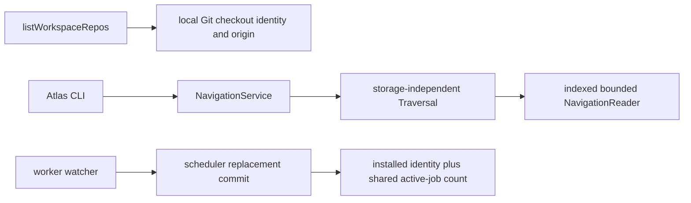

# V5 final independent quality audit

**No candidate qualifies for all-metric superiority. Do not deploy or tune.** All ten delivered patches pass the relevant behavioral checks. Their maintained tests reject original production. However, both final Python generations are invalid 600-second timeouts. Ponytail Python also introduces two required Atlas violations. All four holdout patches enlarge an already oversized test-suite callback. Passing review checks cannot complete an invalid generation.

This audit covers all six `revisionTwo` patches and all four `holdoutOne`/`holdoutTwo` patches. It follows `plan.json`, `finalFreeze.json`, `initialQuality.md` and `revisionOneQuality.md`. **R** means frozen candidateTwo (`da4417ae2056…`); **P** means exact Ponytail (`ba68ff26239c…`). One/Two identify the holdout draw. Artifact identities were visible. This is an independent quality audit, not formally blinded scoring.

No profiles, transformed instruction bodies, private/raw/auth logs or credentials were opened. No model runs, installs, application services, deployment, skill changes or profile changes occurred. All source execution used disposable copies. The frozen profile remains unchanged.

Machine results: [gateResults.json](gateResults.json). Evidence root: `/home/leon/.cache/codingSessionV5/reviews/final/`. Its [inventory](file:///home/leon/.cache/codingSessionV5/reviews/final/inventory.json), [check index](file:///home/leon/.cache/codingSessionV5/reviews/final/checkResults.json) and [public evidence summary](file:///home/leon/.cache/codingSessionV5/reviews/final/evidenceSummary.json) link commands, artifacts, exits, durations and outputs.

## Executed gates

Counts are executed maintained tests, not counts of added tests. Original controls retain the final delivered tests and snapshots and restore only production. Failures below are behavioral assertions, not setup failures. No maintained suite was skipped.

| Patch | Maintained candidate | Original production control | Quality qualification |
|---|---:|---:|---|
| R TypeScript | 4 pass | 2 fail, 2 pass | Relevant behavior/type/lint/size pass. |
| P TypeScript | 4 pass | 2 fail, 2 pass | Relevant behavior/type/lint/size pass. |
| R Bash | 3 methods; 15 scenarios | 9 scenario failures | Behavior/syntax/size pass; 8 advisory Atlas findings in delivered support/tests. |
| P Bash | 3 methods; 15 scenarios | 9 scenario failures | Behavior/syntax/size pass; 9 advisory Atlas findings in delivered support/tests. |
| R Python | 59 pass | 5 fail, 54 pass | Required Atlas clean; generation invalid; repository closure incomplete. |
| P Python | 62 pass | 1 fail, 61 pass | Required Atlas fails; generation invalid; repository closure incomplete. |
| R One scheduler | 8 pass | 4 fail, 4 pass | Behavior/type/lint pass; inherited suite-size debt worsens. |
| P One scheduler | 9 pass | 4 fail, 5 pass | Behavior/type/lint pass; inherited suite-size debt worsens. |
| R Two scheduler | 12 pass | 10 fail, 2 pass | Behavior/type/lint pass; inherited suite-size debt worsens. |
| P Two scheduler | 9 pass | 6 fail, 3 pass | Behavior/type/lint pass; inherited suite-size debt worsens. |

All ten independent acceptance reruns pass: 4 checks per workspace patch, 11 per Bash patch, 5 per Python patch and 3 per scheduler patch. Both TypeScript source suites pass **29 tests**. Scheduler/watcher suites pass R One **12**, P One **13**, R Two **16**, P Two **13**. Each Python patch also passes the affected coffee/pipeline/check/report shard: **125 tests plus 78 subtests**. These checks do not replace the full importer requirement.

All six TypeScript type checks and changed-file ESLint checks pass. Both Python Ruff and Pyright checks pass with the pinned interpreter explicitly selected. Bash syntax passes separately; it does not discover behavior tests. Explicit unittest discovery executes the three maintained methods and their scenarios. Python collection confirms all 59/62 navigation items. Bun output confirms the TypeScript test collection and execution.

## Regressions and instruction limits

**P Python introduces two required-policy failures against a clean original.** Whole-project `atlas check --f .` reports `CoffeeNavigation.exact_edge_budgets` nested loops **1/0** at `atlas/tests/coffee_navigation.py:290`, and `assert_distinct_budget` weighted complexity **11/8** at `:328`. R Python and both immutable original exports exit 0 with no diagnostics. These are final-patch regressions, not inherited debt. See [P required check](file:///home/leon/.cache/codingSessionV5/reviews/final/checks/P/py/candidate/wholeCheck.stdout) and [comparisons](file:///home/leon/.cache/codingSessionV5/reviews/final/atlasComparison.json).

**All four holdouts worsen an existing size violation.** The original `worker/scheduler.test.ts:47–147` `describe` callback is already **101 lines**. It becomes R One **162**, P One **182**, R Two **241**, P Two **230** lines. Independent TypeScript AST enumeration and Atlas agree. These are not four new threshold crossings: diagnostic counts remain **28 → 28**, while the same finding becomes larger. Strict changed-function enforcement flags every enlarged container. Under a literal “new functions only” reading, the newly added individual test functions pass. This distinction does not change the all-metric decision. See `checks/*/hold/{candidate/sizes,original/baselineSizes}.stdout`.

No changed code file reaches 600 lines; the largest is P Python's 429-line `coffee_navigation.py`. No changed Python function or individual new TypeScript test body reaches 100 lines. Both development TypeScript suites now stay below the function limit, unlike P in revisionOne. The inspected additions preserve precise TypeScript types, `Array<Type>` notation and domain guards without redundant runtime shape validation.

**Bash adds advisory test/support debt, not a newly invented task gate.** Whole-project default Atlas counts change R **32 → 40**, P **32 → 41**. Two findings per patch concern the byte-identical copied frozen command fixture: `curl` complexity **22/8** and `main` **13/8**. Authored tests add DevPod complexity **15/8**, nested loops **3/0**; SDK complexity **13/8**, decision depth **4/3**, nested loops **3/0**. R success tests add nested loops **2/0**; P success tests add complexity **15/8** and nested loops **3/0**. The four-level decision nesting deserves a warning. This repository does not mandate Atlas or declare these default thresholds, so these findings remain advisory rather than retrospective acceptance failures. No Bash production-analysis coverage is inferred from checking Python support files.

Full-project supplemental Atlas also runs on all six TypeScript patches against immutable originals, using unchanged pinned checker source. Development TypeScript stays **28 → 28** without new/worsened diagnostics. Holdout changes only worsen the existing suite-length finding. Other inherited findings remain identified separately.

All six TypeScript patches include the manifest-created absolute `node_modules` symlink. This is setup contamination, not authored application functionality. Do not ship it. Frozen measurements retain it rather than silently removing its bytes/file count. The frozen classifier also calls extensionless `manual_deps` “other”; its actual production changes are byte-identical across R/P. Folder placement similarly changes whether the copied Bash double counts as tests or fixtures. These categories must not support a false production/test-size win.

## Architecture, contracts and test safety

The production changes remain at their existing owners. No dependencies, README edits, schema changes, migrations, configuration changes or unrelated production redesign appear.

Both workspace production patches are byte-identical (`src/workspaceRepos.ts:55–78`). Physical root comparison rejects inherited origins, bare/admin directories and non-root children. Discovery still uses immediate directory entries without following child symlinks. Returned paths keep selected-workspace spelling. Origin failures still skip the child. R tests actual linked worktrees, including one without origin; P tests a separate Git directory, not an actual linked worktree. Both exercise real local Git, spaces, trimming, exclusions and workspace symlinks. No remote is contacted.

Both Bash production patches are byte-identical (`manual_deps:29–65`). Standalone commands restore errexit propagation; HTTP failure flags reject error payloads. Existing pipefail, OS selection, packages, location, mode and successful phase ordering remain. Tests execute the actual installer with inert frozen command doubles inside nested bubblewrap isolation. No real package manager, network, privilege change or user home is available. Darwin is simulated on Linux, not natively validated. Shared frozen doubles make the maintained assertions meaningful but not wholly independent failure simulators.

Both Python patches make the same traversal logic change (`navigation_walk.py:44–57`), differing only in comments. A finite `max_edges + 1` adjacency prefix accounts for already included ordinals and one possible omission. It preserves ordinal order, BFS ownership, node/depth limits, unresolved boundaries and first-parent reconstruction. The existing service, CLI and indexed reader remain connected; no unlimited/full-graph fetch replaces the port.

R uses existing indexed samples for exact inheritance budgets in five languages, ordered Python CALLS evidence, path-parent evidence and direct service/CLI parity. P uses Python exact/short inheritance budgets in all directions, omitted-edge boundaries, ordered evidence/path assertions and three negative assertion controls. Both original controls fail maintained assertions before snapshot comparison. R's five failures expose exact-budget truncation across languages; P's failure exposes the missing distinct CALLS evidence. Different coverage breadth is not a test-size quality score.

**Snapshot compatibility passes.** R preserves all existing responses exactly: Python **19**, plus **23 each** for Java, JavaScript, Kotlin and TypeScript. It adds 5 Python responses and 2 per other language. P preserves all 19 Python responses and adds 11. No existing key is removed or changed. No fixture source, extraction, graph, check or report baseline changes. Structural evidence: [snapshotChanges.json](file:///home/leon/.cache/codingSessionV5/reviews/final/snapshotChanges.json); actual maintained tests corroborate the snapshots.

## Heldout scheduler semantics

All four production fixes use a unique schedule-set identity (`worker/scheduler.ts:53–87`). A callback checks identity before incrementing the shared active-job count. Candidate identities remain inactive while building. A failed build never commits its identity, leaving current callbacks functional and discarded callbacks inert. Successful replacement commits before stopping old schedules, preventing old `stop()` callbacks from starting work. Resumed current schedules can run. The shared count and `finally` release remain outside the identity lifetime, so retired in-flight work settles and protects later non-overlapping jobs until every run finishes.

Maintained regressions cover retired callbacks, failed replacement, removal/readdition, overlap, errors and real paused Croner support. Both second-draw suites also check synchronous factory/stop/resume callbacks. R Two explicitly queues a callback before retirement. Existing tests preserve disabled-job handling, duplicate-name/monitor rejection, cleanup, stop behavior and enabled-name order.

**Coverage gap, not repair:** none of the four delivered suites combines a failed replacement with multiple already-active overlapping runs. First-draw suites also lack the synchronous factory/cleanup callback probe. Four independent reviewer tests check these cases, queued callbacks, staged success/error settlement, exact overlap release and stop-with-active-work. Every candidate passes all four without production changes. This supplement does not become delivered coverage or improve frozen test metrics.

The supplement's original controls show two assertion failures, one framework timeout and one passing stop control. The composite in-flight test can wait on work wrongly started by original production; its 5-second timeout is **not** counted as an assertion-based kill. The delivered maintained controls already supply behavioral catches-original evidence. Supplement source and logs remain in the final evidence folder; the added files were removed from disposable source trees before final delivered Atlas comparisons.

## Completion, required closure and activation

Both Python agents exit **124 at 600.001 seconds**, with `audit.valid=false` and `settled=false`. R has 51 tool starts/50 ends; P has 37/37. P has no final summary; R's retained last assistant text is a progress update promising another Atlas check, not a completed final reply. R's final policy is clean in this audit, but that cannot make its interrupted generation valid. This regresses completion from revisionOne, where both Python agents settled before the deadline.

Public traces retain unfinished whole-suite validation: R's **240-second** attempt and P's **300-second** attempt. Independent full-suite attempts also stop at **110 seconds** and remain incomplete. Full collection finds R **1968** and P **1971** importer items. Progress dots without a final result do not establish full-suite success or absence of later failures.

Python repository instructions also require dashboard build, tests, type checking and lint. Bounded independent attempts retain separate exits: build **1**, tests **1**, types **127**, lint **127**. Missing Vite, React/Drizzle/typescript-ast and tool availability block closure. Dependency-free tests run, but the dashboard suite does not pass. These are unavailable-environment results, not demonstrated navigation regressions. Nothing was installed to repair them. No successful full importer/dashboard closure is claimed.

All eight non-Python generations settle validly. Their final behavioral/type/lint claims are supported by reruns. Holdout “no blockers” statements omit the enlarged inherited suite-size debt. The reports otherwise state that full application/live-service checks were not run.

Native activation records are valid for nine artifacts, including R Python, but activation is not completion. **P Python's actual `activation.json` and audit activation are false: 24 request-context observations versus 23 assistant messages.** All observed hashes match; this count mismatch does not prove changed injection content. The aggregate results also report `activationValid=false`, consistent with the artifact. This audit makes no provider-wire or billing claim and does not open instruction bodies.

## All-metric decision

| Completed comparison | R / P generation seconds | R / P Pi USD | R / P total tokens |
|---|---:|---:|---:|
| Development TypeScript | 151.532 / 67.884 | 0.176862 / 0.101791 | 222955 / 87701 |
| Development Bash | 100.309 / 101.606 | 0.096252 / 0.133814 | 144102 / 140226 |
| Holdout One | 132.912 / 104.793 | 0.099741 / 0.108266 | 125085 / 152289 |
| Holdout Two | 181.913 / 142.040 | 0.154785 / 0.154480 | 262254 / 157336 |

These single draws show ties and resource trade-offs, not universal improvement. TypeScript and Bash production tie exactly. Heldout production additions/deletions/files/LOC tie within each draw, while resource directions differ. Correctness ties on executed checks. Invalid Python resource figures remain preserved as descriptive evidence, not eligible completed comparisons. Smaller tests, final-reply density and aggregate scores are not treated as quality wins. Public Pi cost is not an invoice; provider-wire identity and billed cost remain unavailable.

CandidateTwo fails the frozen invalid-completion gate. CandidateOne did not meet all-metric strict superiority in revisionOne. Neither prior evidence nor this holdout supplies a qualifying candidate. This conclusion holds even under the narrow new-functions-only size interpretation. No tuning, resampling or deployment follows this review.

## Reproducibility limits

The final folder retains **110 supplemental command records**, including failed, blocked, repeated and timed-out attempts. Each child limit is 110 seconds; each enclosing tool-command limit is at most 120 seconds. Sandboxes expose original workspaces and Git metadata read-only. Whole-project baselines use immutable exports. All delivered changed-file bytes and symlink targets still match the disposable candidates after checks; allowlisted public evidence hashes match published values.

The reused helper initially used installed Bun 1.4.3. All six TypeScript maintained candidate/control pairs were repeated with frozen Bun 1.3.11 and agree. Acceptance already uses that pin. The first external holdout Atlas attempts included reviewer tests; corrected `externalDeliveredWholeCheck` runs exclude them. Both attempts remain visible. See [inspectionAttempts.md](file:///home/leon/.cache/codingSessionV5/reviews/final/inspectionAttempts.md) for these qualifications and the supplemental original timeout.

Unfinished or unavailable: whole importer completion, successful dashboard closure, native macOS validation, provider invoice/wire verification and formal unbiased scores. Relevant passing checks do not remove these limits.
