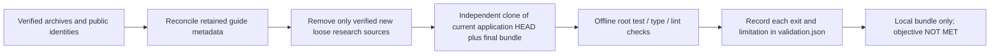

# V5 independent package audit

## Decision and scope

**Approve the two verified archives for local retention only. One metadata objection blocks a clean whole-bundle handoff. Root validation remains pending. No public push, deployment, new trial or new judge is authorized.** The study objective remains **NOT MET**.

I read the plan, decisions, freeze, evaluation, replay, result families, quality reviews, blind review, mutation report, provenance and publication manifests. I checked archive bytes without extracting or executing study code. Executed checks were hash/mode/path comparisons, Git object reads, Python/TypeScript parsing and Bash syntax parsing only. No model, test trial, install, source edit, credential-source read, private/raw-stream read, deletion or live-skill change occurred. Only these two audit reports were written.

## Blocking objection

**B1 — retained replay metadata is stale.** `archives/packaging.json:26` lists `replay.md` at SHA-256 `9ed8ad50c1caff8674987b4d1ecaa18478b37fbdc010b6138854b219091933e3`, 14,028 bytes. The current guide is `118f9a177ff857420129841e825be0c9c749b4acd510a4ced779b42333b5b465`, 13,998 bytes. The other 26 retained entries match their recorded bytes, sizes and modes. Reconcile this retained-file entry with the intended final guide and verify it again before calling the whole bundle consistent. Neither archive needs rebuilding for this outside-archive mismatch. This audit does not change the guide or manifest.

**Pending final gate, not a demonstrated test failure:** `validation.json` does not exist at this audit snapshot. The references in `evaluation.md:116` and `replay.md:135` are not executed validation evidence. No repository-root test, type-check or lint pass is certified here. Local archive approval is not final application/package validation.

## Archive verification

| Archive | Files / directories | File bytes | Compressed bytes | SHA-256 |
|---|---:|---:|---:|---|
| `archives/sources.tar.gz` | 112 / 23 | 664,656 | 205,776 | `21e29b1c57a0b1288a051cef30e302496ff1b2c1e1a5f0c99beaaf26ecd62b15` |
| `archives/evidence.tar.gz` | 2,819 / 221 | 13,401,981 | 1,854,549 | `5d8f48b45bd7b874a947e3d587cc47c90d26f5b75e50c1b20a59f24cac01bce9` |

Every member matches the current inventory's type, mode and size; every regular file matches its SHA-256. Names are unique, sorted, canonical safe relative paths, without parent traversal, absolute paths, backslashes, colons or control characters. Both archives contain only regular files and directories. There are no symbolic links, hardlink entries, special files, special permission bits, link targets or PAX overrides. UID/GID/mtime are zero. File modes are `0644`; source directories are `0755`; evidence directories preserve `0755` or `0700`. Current allowlisted source files and directories also match these bytes and modes.

I verified the **current compacted metadata**, not obsolete builder output bytes. `sourceMembers.json` hashes to `a8f84311611402124b0d51f0957063b24a3b90ff47c52785c4e73e4c5c3a3c3f`; `evidenceMembers.json` hashes to `89ab150de637237087461f76f3c02f9e9dd944e58f74509d97fcd141baa79091`. Both agree with `packaging.json:3`. Both `.sha256` files agree with the archive bytes. The recorded packaging-script and frozen allowlist hashes also match their current public packaging inputs.

The source inventory contains **53 baseline files, 43 case files and 16 harness files**. No loose baseline/case/script source is missing from the archive; the five excluded files are generated Python bytecode, not source. All four case preparation inventories pass. All 30 case source-pin entries match their pinned repository blobs, including extensionless `manual_deps`. All **124 captured input records** across run/control evidence resolve to matching source-archive bytes. External task repositories, dependencies and tool binaries remain prerequisites, not bundled source claims.

All **2,819** `exactCachePaths` rows map one-to-one to evidence members, with matching original absolute locator, hash, size and mode. Source members map relative to the study root; evidence members map relative to `/home/leon/.cache/codingSessionV5`. All **38** public integrity inventories are complete and verify **1,536** referenced hashes. This includes 26 launch attempts and 12 preparation controls, including superseded controls. Historical scratch/workspace/private locators are not promises to archive those directories. Reports, profiles and summary metadata remain outside the archives as declared.

## Original baseline, license and launchers

All **49 original resources** match provenance SHA-256, sizes, Git blob IDs and Git modes, both against upstream commit `84740e3d344b69b4a133201fa519eb37a62a2b2a` and the current upstream retrieval checkout. The original main skill matches `profiles/replica.md` at `ba68ff26239c3c3b05b2a9a47ee0d9a6b93a69639a2555ec87a5d44bffaf2f0c`. Original extension, hooks, cleanup scripts, aliases and retained benchmark definitions are preserved. This is the documented Pi subset, not the complete cross-host distribution (`baseline/integration.md:5,54–56`).

The MIT copyright and permission notice remain byte-exact in `baseline/upstream/LICENSE`, SHA-256 `fb1bc6909ac3ef82d5c22106e32ef682b0cff66788fa915fb9b53b15c9d2f3ab`. Original `benchmarks/agentic/tasks.py` has **1,544 lines**. Keeping that licensed third-party file unsplit is correct preservation, not an authored-file size claim. The current baseline text says **49 originals**; the separate observer is not a fiftieth original.

Launcher checks did not rely on filename suffixes. I inventoried shebangs and modes, all 16 harness files, all four identical case launchers, the eight generated extensionless command doubles (`uname`, `sudo`, `curl`, `brew`, `chsh`, `zsh`, `rm`, `sdkApplied`), and the pinned extensionless installer. The doubles copy the archived `fixtureCommand.py`; they are not missing independent source files. The four extensionless `mutations/*/{py,ts}/pristineSource` members are preserved source, not executable launchers. External interpreter/tool launchers are declared prerequisites; they were not installed or executed.

All **31** frozen manifest shell commands and **211** archived review/mutation command files pass Bash syntax parsing. Every archived Python code file parses; TypeScript/JavaScript authored function spans were enumerated with TypeScript. The 42 suffix-identified authored source/helper files are below 600 lines; the largest is `summarizeResults.py`, **579 lines**. All 204 Python functions are below 100 lines (largest 85); all 63 TypeScript/JavaScript authored functions are below 100 (largest 51). The four extensionless preserved source copies are 81–82 lines; their Python functions also parse and remain below the bound. These checks do **not** erase the separately reported oversized callbacks in generated implementation patches.

`runTrial.py` owns launch/check orchestration; `sandboxTrial.py` owns process/filesystem effects; `providerProxy.py` owns restricted provider transport. Only `run` authorizes a model launch when separately approved. Native probes are mocks, not launch permission. Original external-host activation/cleanup and upstream model/judge runners must not be executed during offline package validation. Inner case launchers use a broad read-only `/` bind and must remain inside the outer allowlisted sandbox, as replay requires; direct host execution is not equivalent isolation.

## Evidence, accounting and interpretation

All **26 unique result identities** equal the archived global ledger and the live public ledger copy. Each run's result hash map and captured measurement match the archived evidence. The initial/revision/holdout result subsets are identical to their entries in `results.json`; reporter, plan and amendment hashes agree.

There are **25 actual implementation generations: 20 valid and five invalid Python timeouts**, plus **one infrastructure launch**. The infrastructure entry's historical `modelLaunched=true` means the Pi process was launched; it does not prove generation. Its audit has zero assistant messages/tools/activation observations and unavailable usage. It remains charged to the 30-attempt ledger. The lock-directory mount amendment is documented in `amendments.md:5`; it is the sole plan infrastructure-pin mismatch, not an undisclosed model-output repair.

The 25 implementation captures have acceptance/native exits zero. Independent quality reviews still disqualify completions/policy/size where recorded. Summing archived usage gives **8,556,038 tokens** and **USD 4.367076 Pi-reported cost**, within normal floating-point representation. Every per-run input/output/cache total and cost component reconciles with the result metrics; all nine stage/arm aggregate rows in `evaluation.md:41–51` agree. Reasoning is part of output, not an extra total. Cache-write is zero where reported. Raw finalized provider messages were intentionally not opened, so this verifies public accounting and its implementation, not a provider invoice or independently recovered interrupted usage.

All 26 `nativeProof.json` files explicitly describe an **offline factory/observer mock**, with runtime/provider proof false. Actual `activation.json` observations are a separate instrument: **23 valid, three invalid**. Invalid records are the infrastructure launch, initial legacyNative Python, and revisionTwo Ponytail Python. Both Python count failures have **24 contexts / 23 assistant messages** with matching observed hashes. The other invalid generations remain invalid despite activation passing. The observer establishes the recorded Pi pre-provider-conversion section boundary, not provider-wire identity, remote receipt or semantic compliance (`scripts/nativeTrace.ts:7–29`, `nativeTrial.py:134–161`).

The final interpretation is supported: no strict all-metric win, no bounded all-resource Pareto win, no winning deployment. Correctness ties, invalid completions and resource trade-offs cannot be averaged into success. Extensionless production classification and the setup-created `node_modules` patch symlink are disclosed; patch text containing a symlink is not a tar symlink. Do not ship that setup link as application code. Four revisionOne mutation kills do not apply to candidateTwo/holdout. One same-model blind grader's 16 cells, coarse ties and described rather than supplied verbosity control remain limited evidence. No paid judge repetition is needed for package integrity.

## Publication privacy review

I reproduced the ten publication pattern rules over every archived file. The two potential matches exactly match `secretScan.json`; its SHA matches `secretReview.json`, and both reviewed source-member hashes match. Context supports both synthetic classifications: a fixed benchmark HMAC tampering fixture and a scrub unit assertion. **No match value is printed in either audit report.** No redaction or evidence rewriting is needed for those fixtures.

All 26 sanitized tool traces retain only the allowlisted fields: **730 starts / 725 ends**. No raw provider event-record pattern appears in the checked public non-code artifacts. No private/auth/raw-stream member or full dependency/run workspace is copied. Public code and invocation metadata can name private paths without containing their target files. Numeric reasoning usage and hash/byte counts are not provider-thinking streams. I did not compare against or open original credentials/private streams. Pattern scans and reviewed allowlists do not prove the absence of encoded or otherwise unrecognized secrets; public release would need separate authorization and review.

## Parent cleanup and validation plan

**Architectural fit: compatible with explicit cleanup boundaries.** Research is not an application dependency: root `package.json` discovers `./extensions`, `./skills`, `./prompts`, `./themes`, while broad `bun test` and `eslint .` can discover loose research code. Archive-only source placement prevents that accidental discovery without changing production configuration.

Retain `baseline/integration.md`, `baseline/provenance.json` and `baseline/checks.json`, plus the direct reports/profiles/manifests/replay guide. `removableSources.json` includes those three retained files and explicitly says deletion is not authorized: do not execute it as an unconditional delete list. Subtract retained guides, confirm each remaining path is a new owned loose source with matching archive bytes/mode, and do not delete original repositories, upstream retrieval files, dependencies or cache parents. No unarchived source repair is needed. Keep the MIT notice inside the preserved archive and beside any later extracted upstream copy.

After the successful metadata recheck, removal of exact owned private credential **copies** is compatible with offline replay. Never target original auth, owner settings or a whole private/cache parent. No credential access is needed to validate the public archives. This audit has not performed or certified cleanup.

Validate a new independent clone of **current HEAD `0ead6bdcec3f53342b3ccb5718e3b2824ba86df1`**, with copied Git objects/no worktree registration and the final untracked bundle explicitly copied in archive-only layout. A clone alone will omit this untracked study. Do not reset the original repository to case base `7754bba086197ba0acce343dc62c560e6fcede0d`; its recorded advancement is external, not an experimental patch. Run the current root test/type/lint scripts without installs or `--fix`, in an isolated environment without auth, provider access or live services. Record command, tool versions, base, layout, exits, failures and exclusions separately. Recheck archive hashes afterward. Passing these checks would validate that layout against current application code, not retroactively complete timed-out generations.

Read-only mounts protect against writes **from the sandbox**. They do not make host repositories or dependencies immutable against external changes. Input/package snapshots and pinned Git blobs have stronger content identity; ambient dependencies remain external and mutable. Recheck fingerprints before replay and record validation-environment drift. Historical preparation verification can correctly fail on current HEAD/toolchain or file-set drift. Do not call that evidence corruption or reset user state to force a pass.

## Nonblocking limitations

The bundle is not hermetic. It depends on local Git objects, absolute paths, Linux Bubblewrap and separately fingerprinted tools/dependencies. Full importer/dashboard closure, native macOS/PowerShell execution, provider billing/wire identity and broad fault coverage remain unverified or incomplete as reported. Auth copies can be removed without making public offline verification impossible; retained-workspace `check` is still not reproducible from an evidence archive alone. Hashes provide content identity, not signatures or semantic security guarantees. These limits do not invalidate the verified local archives and do not authorize publication.
