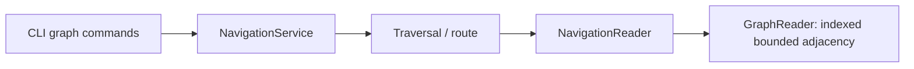

# V5 revisionOne independent quality review

**No all-metric superiority or deployment recommendation.** CandidateOne removes the initial Python required-policy regression and all six generations now complete validly. Correctness ties, resource trade-offs, incomplete repository validation and fresh Ponytail quality failures prevent a universal win. Smaller regression suites are not evidence of greater quality.

Reviewed `reviews/initialQuality.md`, `plan.json`, `candidateOneDecision.json`, all six final patches, public traces/summaries and affected workspace contracts. No profiles, transformed profile bodies, holdout, private/raw/auth logs, model trials, mutation work or original-workspace edits. Only this report and a new review-cache folder were written; initial review artifacts remain intact. One permitted revision remains; this review does not authorize or run it.

**Labels:** R = candidateOne `7f02836af76a…072dab5809a47`; P = fresh exact Ponytail `ba68ff26239c…9d07b1e583f4`. Full run paths are in `inventory.json` under the evidence root below. This is artifact-first independent review, **not formally blinded scoring**: arm hashes/decision were already visible. Numerical blinded ratings remain unavailable.

## Gates by patch

“Pass” below concerns the frozen task's behavior, maintained regressions, safeguards and size limits, not an assertion that every repository check completed. Advisory Atlas defaults outside the Atlas repository are distinguished from repository-required policy; no retrospective acceptance rule is added.

| Patch | Independently executed maintained checks | Original production, final tests retained | Quality gate |
|---|---:|---|---|
| R TypeScript | 5 tests | 2 behavioral failures | **Pass.** No new Atlas diagnostics; all functions below 100 lines. |
| P TypeScript | 6 tests | 4 behavioral failures | **Fail size constraint.** Expanded suite callback is 108 lines. |
| R Bash | 3 methods, 15 scenarios; no skips | 9 scenario failures | **Behavior/size pass; advisory quality warning.** 10 new default Atlas diagnostics in delivered test/support files. |
| P Bash | 3 methods, 15 scenarios; no skips | 9 scenario failures | **Behavior/size pass; advisory quality warning.** 9 new default Atlas diagnostics in delivered test/support files. |
| R Python | 59 navigation tests | 1 behavioral failure, 58 pass | **Relevant quality checks pass; repository closure incomplete.** Required whole-project Atlas check is clean. |
| P Python | 59 navigation tests | 1 behavioral failure, 58 pass | **Fail required quality check.** Five new Atlas violations; repository closure also incomplete. |

All six independent acceptance reruns pass: TypeScript 4, Bash 11 and Python 5 checks per patch. Both TypeScript type/focused-ESLint checks pass; both Python Ruff/Pyright checks pass with the pinned interpreter explicitly selected. Bash syntax passes separately—it does **not** discover the maintained behavior tests. Explicit `python3 -B -m unittest discover -s tests -v` executed those tests.

Both Python patches additionally pass the same broader **220 tests plus 78 subtests**, and the same coffee/check/report shard **125 tests plus 78 subtests**. These overlap: do not add their counts together. The public model claim of 220 tests is thus corroborated by a final-workspace rerun, not accepted on trust. Collected navigation IDs and commands are retained. Neither supplemental shard completes the mandated entire importer suite.

## Findings and contracts

**P TypeScript violates the explicit function-size bound.** `src/workspaceRepos.test.ts:34–141` contains a 108-line `describe` callback, despite every individual test body being shorter. Independent TypeScript AST enumeration and full-project Atlas agree. R's largest callback is 80 lines. No changed code file exceeds 600 lines; the largest is P's 439-line `coffee_navigation.py`. No new Python function reaches 100 lines. Evidence: `checks/{R,P}/ts/candidate/sizes.stdout`, `inventory.json`.

**P Python introduces required policy failures against a clean original.** At `atlas/tests/coffee_navigation.py:283`, `distinct_edge_budgets` has weighted complexity **24/8**, decision depth **4/3** and nested loops **7/0**. At `:318`, `exact_import_budgets` has complexity **11/8** and nested loops **2/0**. The final patch still fails after the generation's last helper edit. R's final patch and both immutable original exports exit 0 with no violations. This is not inherited debt or a dependency failure. Evidence: `checks/{R,P}/py/{candidate/wholeCheck,original/baselineWholeCheck}.*`.

Full-project Atlas was also executed on **both other projects**, candidate versus immutable original, using the pinned unmodified checker source. TypeScript has **28 → 28** diagnostics for R and **28 → 29** for P; the sole addition is P's callback. Dotfiles has **32 → 42** for R and **32 → 41** for P. Neither project declares an Atlas check/policy in its applicable instructions, so these default-policy findings are advisory, not newly invented frozen task failures. They must still not be described as clean quality results.

For Bash, two added diagnostics in each arm concern the **unchanged copied frozen fixture**: `curl` complexity 22/8 and `main` 13/8. These are newly delivered debt, not newly authored logic. The remaining R diagnostics concern `execute` (complexity 9), DevPod tests (complexity 18, nested loops 4), SDK tests (complexity 16, decision depth 4, nested loops 4), and success tests (complexity 10, nested loops 2). P has `execute` complexity 9, success complexity 15/nested loops 3, DevPod complexity 24/nested loops 6, and SDK complexity 9/nested loops 2. Common defaults are complexity 8, decision depth 3 and nested loops 0. See `atlasComparison.json` for exact paths and unchanged original findings. No Bash production analysis coverage is inferred from analysis of its Python fixtures.

**Production placement fits all six patches.** TypeScript retains `listWorkspaceRepos` ownership (`src/workspaceRepos.ts:45–81/82`), immediate directory filtering and origin-failure skipping. Canonical identities exclude inherited/bare/admin roots without assuming `.git` is a directory; returned path spelling stays selected-workspace-relative. R exercises real linked worktrees created in temporary Git fixtures; P uses minimal linked-worktree metadata interpreted by real Git, not a fully created worktree. P separately tests a workspace nested below the parent root; R tests root/symlink variants. Both maintain meaningful exclusions and symlink/space coverage.

The two Bash production patches are **byte-identical**. They preserve `set -euo pipefail`, OS branches, package commands, installation location/mode and successful phase order (`manual_deps:29–65`). Owned tests run the actual script with inert frozen command doubles inside nested isolation. They cover six Linux DevPod failures, six cross-route SDK failures and three successful OS routes. P has more exact sequence assertions; R is less exhaustive about successful sequencing but acceptance supplements it. Original controls fail on false successful completion, not sandbox setup. These suites share the frozen doubles with acceptance; they are meaningful maintained assertions, not wholly independent failure simulators. Simulated Darwin is not native macOS validation.

The Python production changes differ only in their comment. They stay at the storage-independent traversal owner (`navigation_walk.py:45–55`), retaining the existing port, indexed adjacency, queue, node/depth handling, unresolved boundaries and first-parent reconstruction:

Actual wiring: `cli/graph.py:28–46`, `services/navigation.py:51–65`, `services/factories.py:14–18`, `persistence/navigation.py:126–133`, `navigation_queries.py:52–59`. A `max_edges + 1` prefix bounds every request and supplies enough distinct evidence or a genuine omitted edge; rediscovered included ordinals cannot exhaust that prefix without either filling the edge budget or leaving room for a new edge. No full-graph fetch, new production abstraction/dependency, migration, storage change, schema change or unrelated redesign is introduced. Existing maintained tests exercise filtering, depth/node cutoffs, read-only snapshots and indexed finite reads.

**Python regressions are substantive, with different breadth.** R's shared production-indexed coffee helper checks ordered evidence at budget 7, first-discovery path evidence/uniqueness at budget 40, and short/exact inheritance budgets 1/2 (`coffee_navigation.py:282,299,317`). It reaches the service through the real CLI but adds no separate direct-service parity assertion. P checks budgets 7/8/11, node order, first-parent retention, exact/short IMPORTS budgets in all directions and explicit direct-service/CLI parity (`:283,318,339`). P's broader test matrix does not excuse its policy failures; R's smaller matrix is not a coverage win. Both original controls fail a maintained evidence assertion **before snapshot equality**.

**Snapshot compatibility passes.** Only Python navigation snapshots change; both retain all **19 existing responses exactly**, with no removed/modified existing keys. R adds 8 responses; P adds 19. No coffee source, extraction, graph, check or report baseline changes. New snapshots retain metadata/evidence and reflect the maintained assertions. File identity checks and actual tests corroborate this; model summaries alone do not. Evidence: `snapshotChanges.json`, final `changes.patch`, owned-test outputs.

**Delivery contamination remains.** Both TypeScript patches include the manifest-created absolute `node_modules` symlink. It is harness setup, not authored application functionality; do not ship it. Frozen combined metrics below retain its 52 bytes/one file rather than silently rewriting historical measurements.

## Native activation and completion evidence

**Native full-mode injection evidence is valid for all six generations.** The offline factory probe alone is not runtime proof (`nativeProof.json` correctly says so). Separate public `activation.json` records show one agent start, one valid pre-start observation, and a matching context observation for **every assistant message**: R Bash/Python/TypeScript **11/33/15**; P **14/22/13**, totaling 108 contexts. All hashes/validity flags agree with each run's expected instruction/context digests; observer/probe hashes match the inspected pinned source. All six non-profile package file maps are identical; invocations select full mode and load the native extension before the read-only observer.

The native factory writes its structured section (`baseline/upstream/pi-extension/index.js:230–243`); `scripts/nativeTrace.ts:10–27` observes the exact section and rejects redundant raw system append. `nativeTrial.py` audits matching observations/counts. This supports actual Pi runtime injection of the native full-mode transformation, **not merely a raw profile read**. It does not prove provider-wire identity, billing, or live package autoactivation; those narrower limits do not invalidate the injection evidence. Profiles/instruction bodies were not opened for this review. Selected public patches/traces/measurements/activation/summaries also match their published integrity digests.

All six public completion audits are valid, settled, non-aborted, with matching tool starts/ends and agent exit 0 before the enforced **600-second** cap. Unlike initial review, neither Python run is an invalid global timeout: R finishes at **581.958s**, P at **583.889s**. No failed generation was repaired or replaced by this review.

Both Python traces nevertheless show an unfinished whole-suite command: **180s** for R, **240s** for P. Both attempt dashboard checks, but the frozen workspaces lack dashboard dependencies; no successful dashboard build/test/type/lint closure is evidenced. P also emits about **268 KB** during a wrong-interpreter Pyright attempt before correcting it. Broad snapshot searches emit about **671 KB** for R and **532 KB** for P. These are orchestration observations, not diagnosed test hangs or isolated causal effects of individual profile clauses. Semicolon chains sometimes mask earlier command statuses. Final Python replies candidly disclose unfinished checks; P also discloses the Atlas violations. TypeScript/Bash summaries broadly match the checked behavior, but P TypeScript's “no known remaining issues” is too strong given the size violation. R TypeScript's admin-root coverage is implicit in expected-output fixtures. Bash copied support is newly delivered even when its content is unchanged from the frozen fixture.

## Metrics, individually

Times below are generation wall times, not summed parallel command durations or review runtimes. Token/cache/cost figures are public Pi accounting, not provider invoices. Cache-write is **0 in all six**; one-hour cache-write detail, actual billed cost, independently verified upstream response-model identity and permission-denial counts remain unavailable. Reasoning tokens, already included in output, are R Bash/Python/TypeScript **557/3202/1622**, P **915/3732/1995**. Density is raw-DEFLATE(final UTF-8 text)/text bytes, descriptive rather than “higher/lower is better.”

| Patch | Seconds | Turns/tools | Input/output/cache-read/total tokens | Pi USD | Final words | Density |
|---|---:|---:|---|---:|---:|---:|
| R Bash | 92.601 | 11/17 | 33951/3465/87936/125352 | 0.1113456 | 63 | 0.630 |
| P Bash | 113.239 | 14/18 | 28507/4081/131968/164556 | 0.1110208 | 65 | 0.615 |
| R Python | 581.958 | 33/50 | 56166/11456/943872/1011494 | 0.3212792 | 89 | 0.590 |
| P Python | 583.889 | 22/42 | 78122/8904/676352/763378 | 0.3129192 | 87 | 0.594 |
| R TypeScript | 120.163 | 15/28 | 32271/4480/150656/187407 | 0.1244076 | 68 | 0.614 |
| P TypeScript | 143.666 | 13/28 | 38009/5133/120832/163974 | 0.1394312 | 65 | 0.612 |

Each size cell is `add/delete/churn; addedBytes/deletedBytes; resultBytes; physical/nonblank/code LOC; files; rawDEFLATE-addedBytes`. LOC/result bytes cover changed files, not the whole project. “Code LOC” is the frozen comment-prefix heuristic, not an AST count. Raw DEFLATE is level 9 over sorted-path added bytes, not gzip or compressed whole-result size. Snapshot one-line rewrites make line churn particularly misleading.

| Patch | Production | Maintained test/support code | Snapshots | Combined frozen |
|---|---|---|---|---|
| R Bash | 7/3/10; 369/369; 1730; 65/47/39; 1; 153 | 170/0/170; 7472/0; 7472; 170/152/151; 2; 2338 | 0/0/0; 0/0; 0; 0/0/0; 0; 0 | 177/3/180; 7841/369; 9202; 235/199/190; 3; 2432 |
| P Bash | 7/3/10; 369/369; 1730; 65/47/39; 1; 153 | 171/0/171; 7798/0; 7798; 171/154/153; 2; 2395 | 0/0/0; 0/0; 0; 0/0/0; 0; 0 | 178/3/181; 8167/369; 9528; 236/201/192; 3; 2500 |
| R Python | 2/4/6; 218/279; 3507; 81/67/66; 1; 143 | 52/0/52; 3672/0; 23354; 421/362/358; 1; 1031 | 1/1/2; 131348/67703; 131348; 1/1/1; 1; 8222 | 55/5/60; 135238/67982; 158209; 503/430/425; 3; 9273 |
| P Python | 2/4/6; 219/279; 3508; 81/67/66; 1; 141 | 70/0/70; 4840/0; 24522; 439/380/375; 1; 1407 | 1/1/2; 284781/67703; 284781; 1/1/1; 1; 9774 | 73/5/78; 289840/67982; 312811; 521/448/442; 3; 11247 |
| R TypeScript | 11/1/12; 349/44; 2222; 81/75/75; 1; 188 | 97/4/101; 3444/165; 4898; 140/132/132; 1; 1015 | 0/0/0; 0/0; 0; 0/0/0; 0; 0 | 109/5/114; 3845/209; 7172; 222/208/208; 3; 1165 |
| P TypeScript | 12/1/13; 362/44; 2235; 82/75/75; 1; 191 | 104/10/114; 4025/336; 5308; 141/132/131; 1; 1217 | 0/0/0; 0/0; 0; 0/0/0; 0; 0 | 117/11/128; 4439/380; 7595; 224/208/207; 3; 1363 |

**Classification qualification:** frozen `measurement.json` calls extensionless `manual_deps` “other,” reporting zero Bash production files. It also classifies R's copied double as tests and P's as fixtures solely because of folder placement. Above, semantic production includes `manual_deps`, and test/support combines both categories; raw categories and combined totals remain preserved in `evidenceSummary.json`. These are explicitly labeled review views, not retroactive replacement of frozen metrics. Current workspace result sizes/LOC, added bytes and all combined aggregates/compression were independently checked against the published patches. Full before/after LOC, base/result bytes and growth remain available in the evidence files.

R is faster on these three single development comparisons, but **not Pareto-superior across all resources**: TypeScript has more turns, cache-read and total tokens; Bash has more input tokens and slightly greater Pi cost; Python has more turns/tools, output/cache/total tokens and Pi cost. Bash production ties exactly. Python R's added production bytes are smaller by one, yet its compressed added production bytes are **143 versus 141**. Correctness ties and coverage differs. Completeness remains qualified for both Python patches; production scope is restrained in all six, while P's regression helpers are unnecessarily complex under required policy. Replies are clear and concise overall, with the accuracy qualifications above. Formal blinded completeness/overengineering/reply-accuracy/coverage/clarity scores are unavailable, not assumed wins.

## Evidence-backed process issues for the last permitted revision

Plan required checks against the **actual enforced deadline**, reserve closure time and account for offline dependency availability before implementation. These runs still spend 180/240 seconds on unfinished monolithic tests near a 600-second ceiling. Prefer bounded, nonoverlapping shards reconciled to collected test IDs; do not relabel partial coverage as a full pass or treat a blocked dashboard requirement as completed. Keep per-command exits rather than semicolon-chain status alone.

Apply the owning repository's quality and size checks to **tests, callbacks and copied support as well as production**, early enough to act on results. Preserve the distinction between required policy, inherited debt and supplemental defaults; do not silently impose new frozen gates after observing these diagnostics. Maintain coverage obligations while controlling helper complexity—optimizing test size alone would discard real evidence.

Use the pinned interpreter consistently and restrict searches to relevant source/test files; structural snapshot inspection is sufficient where giant one-line snapshots otherwise flood output. Explicitly reconcile authored tests with framework discovery; retain original-production controls, non-skipped inert Bash execution and failed attempts. Audit metric classification/setup artifacts before making resource claims, retaining frozen raw measurements alongside any semantic views. None of these observations supplies a task-specific implementation recipe or isolates a causal profile clause.

## Reproducibility and limits

Evidence root: `/home/leon/.cache/codingSessionV5/reviews/revisionOne/`. `checkResults.json` indexes **52 supplemental command records**, including failures; no supplemental timeout. `checkRevision.py` reuses the initial harness-isolation helper on 12 disposable copies. Children have 110-second limits; every enclosing tool command has a 120-second maximum. Only disposable originals had production restored from immutable HEAD; candidate tests/snapshots were retained. Pure original full-project comparisons use `git archive HEAD`, not the original-production-plus-new-tests control.

Eight initial cross-project Atlas attempts lacked a mounted source module and failed with `No module named atlas`. They are retained as `external*Check.*`; corrected `external*Check2.*` mounts the pinned original Python copy read-only and produces the policy comparisons above. These reviewer setup failures are not candidate regressions. No dependencies were installed. `inspectionAttempts.md` records the distinction. Other evidence: `traces.txt`, `atlasComparison.json`, `snapshotChanges.json`, `normalizedMetrics.json`, `evidenceSummary.json`, and per-check stdout/stderr/commands. Original workspaces and Git metadata were never writable through check sandboxes.

Unresolved: full importer-suite completion, successful dashboard checks, native macOS behavior, formal blinded ratings, billed/provider-wire metrics, holdout generalization and universal superiority. No deployment/profile edit or further trial was performed.
