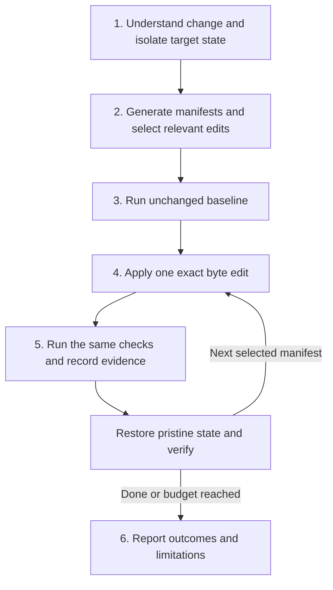

# Change-focused mutation testing

Apply the mutations and run the tests yourself. Do not ask the user to apply edits or run tests manually. Atlas supplies independent manifests with one edit each. It does not provide a test runner or store test outcomes. Use the available tools to execute this workflow and report the results. Ask only when you cannot establish the change scope, required command, permissions, or a safe environment.

## 1. Establish the change and execution boundary

Read the target project's instructions. Inspect its Git status, diff, relevant source and tests. Identify the requested comparison base and target revision. For a PR, compare its base with the proposed code using the merge base. For uncommitted work, include staged and unstaged changes and relevant untracked files. Do not silently substitute the last commit for the requested change.

Record the comparison, target revision, affected behavior and test commands. Derive commands from project instructions, CI and package configuration. Do not guess a universal test command. Before execution, set a limit on the candidate count and a timeout for each command. Use the user's budget or a small default of at most five relevant mutants. Explain any time-based cutoff.

Use a temporary detached Git worktree that you own or a disposable copy of the exact target state. A worktree at HEAD does not include uncommitted edits. If needed, transfer a reviewed patch and relevant untracked files into the isolated workspace. Preserve their paths and bytes. Verify that the resulting source matches the intended state. Never transfer secrets, ignored environments or unrelated user files. If you cannot reproduce the target state safely, stop and explain.

Keep logs, manifests and a pristine snapshot outside the test source tree. Do not mutate the user's checkout, reset or stash their edits, commit experimental mutations, or push them. Execute only approved local test commands. An isolated worktree is not a security sandbox. Avoid production services, credentials, destructive integrations and network side effects. Request permission if safe execution is unclear.



## 2. Generate and select relevant manifests

Use `atlas` if installed. In an Atlas checkout, use `uv run --project /absolute/path/to/atlas/atlas atlas`. Keep that tool path fixed when analyzing another project. Inspect `atlas mutations --help`, `atlas mutations --rules`, and the installed version's configuration contract before configuring rules. Different revisions may use different configuration structures. Check that a format applies before you copy it.

Run fresh analysis against the entire isolated project, not only the changed files:

```sh
atlas mutations --rules
atlas mutations -f /absolute/path/to/isolated-project > /absolute/path/to/run-artifacts/manifests.json
```

If rules are absent or insufficient, enable only the catalog-supported rules needed for this experiment in the isolated project's `atlas.json`. Preserve existing settings. Record this temporary configuration separately from production edits. Do not change configuration in the user's checkout. Prefer fresh analysis. `--saved` requires matching indexed candidates and never refreshes them. Do not initialize or write an index only to perform this workflow.

Select candidates by **behavioral relevance to the change**, not by availability or proximity alone. For every selected manifest, record the details below.

- Identify the changed requirement or behavior it tests. Include evidence from the diff or source.
- Explain why this exact operator replacement models a plausible regression.
- Identify the existing tests that should detect it. State the expected failing assertion or observable difference.

Prioritize edits inside changed expressions. Next, consider directly affected callers, callees or guards when source evidence connects them to the change. An unchanged boundary comparison can be relevant to a new boundary test. Unrelated arithmetic in the same file is not relevant. Changes to tests alone can justify mutations in the production behavior those tests exercise. Do not mutate test code, generated files, vendor files, or unrelated functions only to increase the count. Do not infer runtime reachability from an import alone.

For example, a change to discount eligibility at an age threshold justifies mutating the eligibility `<` comparison to `<=` to test the boundary. It does not justify changing a logging counter's `+` to `-` elsewhere in that file.

Skip irrelevant, duplicate, clearly equivalent or unsafe proposals. Explain representative exclusions. If no supported manifest tests the changed behavior, report **no relevant candidates**. Do not report success or use this result to justify mutating unrelated code. Do not invent arbitrary edits outside the catalog. Require evidence for claims of equivalence. Do not use equivalence as the default explanation for a surviving mutant.

## 3. Establish a passing baseline

Prepare dependencies and build artifacts in the isolated workspace using the project's normal setup. On the unchanged target state, run the exact checks intended for every mutant. Record the command, working directory, exit status, duration and full output outside the source tree. Set an explicit timeout. Stop child processes that exceed the timeout before restoring files.

At minimum, run the relevant tests. Include required compilation and build steps. Identify the actual test runner and confirm that it collected and executed tests. Zero tests or a skipped suite is not a passing baseline. If the baseline fails, times out, or is flaky, stop mutation execution and report it as blocked. Do not classify pre-existing failures as killed mutants. Keep the same commands and environment for the baseline and every mutant. If they change, establish a new baseline.

## 4. Apply one manifest exactly

Start each experiment from the same pristine isolated target state. Verify that the manifest path resolves inside that root. Reject paths or symlinks that resolve outside the root. Read the file as bytes. Verify that its full SHA-256 equals `sourceHash`. Decode the base64 `originalBytes` and `replacementBytes`. Verify that the half-open `[span.startByte, span.endByte)` slice equals the original bytes.

Construct precisely:

```python
mutated = original[:start_byte] + replacement_bytes + original[end_byte:]
```

Write only that one byte edit in the isolated workspace. Do not use global text replacement, character offsets or newline normalization. Do not combine manifests. Verify that the resulting bytes equal the construction above. Inspect the diff before executing. If the hash or span does not match, stop using that manifest and regenerate it from the pristine target. Never guess new offsets.

## 5. Execute, classify and restore

Run the same baseline checks with the same timeout. Record the manifest and candidate IDs, path and span, and rule. Record the exact edit before and after mutation and explain its relevance. Record the command, exit status, duration, log path and outcome. Distinguish these outcomes:

| Outcome | Required evidence |
| --- | --- |
| Killed | The baseline passed. A test assertion or behavior check now fails because of this mutation. Cite the failing test and output. |
| Survived | The same checks completed successfully and actually executed tests. This indicates a possible gap, not proof of equivalence. |
| Invalid | The mutation causes a syntax, type or compilation failure. Keep this outcome separate from assertion-based kills. |
| Timeout | The time limit expired. Do not count this outcome as killed without further evidence. |
| Inconclusive | Infrastructure or setup failed, the result was flaky, the cause was uncertain, or no tests executed. |
| Skipped | The mutant did not run. Give the reason related to relevance, safety or budget. |

Never classify a mutant as killed based only on a nonzero exit code. Inspect the failure. If the cause is unclear, restore and rerun the baseline. Then reproduce the single mutant if the budget permits. Otherwise, mark the outcome as inconclusive.

Use finally-style cleanup to stop spawned processes and restore the original bytes before another experiment. Do this even after test failure, timeout or interruption. Reset source and build state generated by tests. Use only known disposable artifacts or a fresh isolated copy. Do not use destructive cleanup commands in the user's checkout. Verify the source hash and pristine state again. If you cannot verify restoration, stop. Do not run the next mutant on state that a previous experiment changed. Save durable logs before removing the workspace. Remove only the workspace created for this run. Leave pre-existing worktrees and files unchanged.

## 6. Show results

Return a short summary and a table with one row per mutant. Include the file and line, rule and edit, relevance to the change, tests run, outcome, and location of evidence or logs. Include baseline results, comparison and target revision, and temporary rule configuration. Give counts of selected, executed and skipped mutants. State timeout and budget limits. Confirm that you restored the target state and left user files unchanged. Explicitly identify untested behavior and relevant candidates that you did not execute.

If you report a mutation score, define it as `killed / (killed + survived)` for this selected sample only. Exclude invalid, timeout, inconclusive and skipped cases. Report N/A when the denominator is zero. Do not imply coverage of the full project or that all surviving mutants require new tests. Explain each surviving mutant's plausible testing gap and suggest a focused assertion. Do not automatically change tests or production code unless requested. Do not claim that Atlas stores results or shows them in its dashboard. This workflow produces only logs from the agent's execution and a report.
