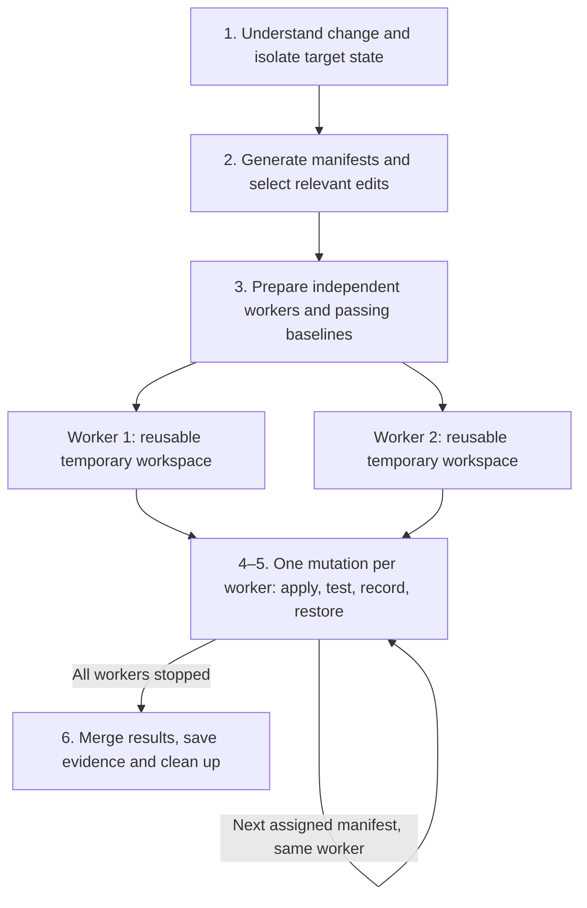

# Change-focused mutation testing

Apply the mutations and run the tests yourself. Prepare temporary workspaces and run independent experiments in parallel when safe. This is an agent-managed workflow; do not change Atlas or add a runner to the target project. Do not ask the user to apply edits or run tests manually. Atlas supplies independent manifests with one edit each. Some versions also provide `mutations run`, but the agent still owns workspace preparation, baselines, parallel execution and evidence-based classification. Use the available tools to execute this workflow and report the results. Ask only when you cannot establish the change scope, required command, permissions, or a safe environment.

## 1. Establish the change and execution boundary

Read the target project's instructions. Inspect its Git status, diff, relevant source and tests. Identify the requested comparison base and target revision. For a PR, compare its base with the proposed code using the merge base. For uncommitted work, include staged and unstaged changes and relevant untracked files. Do not silently substitute the last commit for the requested change.

Record the comparison, target revision, affected behavior and test commands. Derive commands from project instructions, CI and package configuration. Do not guess a universal test command. Before execution, set a limit on the candidate count and a timeout for each command. Use the user's budget or a small default of at most five relevant mutants. Explain any time-based cutoff.

Use a temporary detached Git worktree that you own or a disposable copy of the exact target state. A worktree at HEAD does not include uncommitted edits. If needed, transfer a reviewed patch and relevant untracked files into the isolated workspace. Preserve their paths and bytes. Verify that the resulting source matches the intended state. Never transfer secrets, ignored environments or unrelated user files. If you cannot reproduce the target state safely, stop and explain.

Keep logs, manifests and a pristine snapshot outside the test source tree. Do not mutate the user's checkout, reset or stash their edits, commit experimental mutations, or push them. Execute only approved local test commands. An isolated worktree is not a security sandbox. Avoid production services, credentials, destructive integrations and network side effects. Request permission if safe execution is unclear.



## 2. Generate and select relevant manifests

Resolve an absolute Atlas executable path before creating workers. Use an installed binary that matches the required revision, or build the Rust CLI once with `cargo build --manifest-path atlas-rust/Cargo.toml --release --locked --bin atlas` in the Atlas checkout. Keep that executable outside mutation workspaces and use it for every worker. Do not rebuild the analyzer for each mutant. Inspect `atlas mutations --help`, `atlas mutations --rules`, and the installed version's configuration contract before configuring rules. Different revisions may use different configuration structures. Check that a format applies before you copy it.

Run fresh analysis against the entire isolated project, not only the changed files:

```sh
atlas mutations --rules
atlas mutations -f /absolute/path/to/isolated-project > /absolute/path/to/run-artifacts/manifests.json
```

If rules are absent or insufficient, enable only the catalog-supported rules needed for this experiment in the isolated project's `atlas.json`. Preserve existing settings. Record this temporary configuration separately from production edits. Do not change configuration in the user's checkout. Prefer fresh analysis. `--saved` requires matching indexed candidates and never refreshes them. Do not initialize or write an index only to perform this workflow.

Select candidates by **behavioral relevance to the change**, not by availability or proximity alone. For an explicitly requested workflow benchmark, select a bounded representative sample from the requested components instead. Record that this measures execution performance, not coverage of a code change. For every selected manifest, record the details below.

- Identify the changed requirement or behavior it tests. Include evidence from the diff or source.
- Explain why this exact operator replacement models a plausible regression.
- Identify the existing tests that should detect it. State the expected failing assertion or observable difference.

Prioritize edits inside changed expressions. Next, consider directly affected callers, callees or guards when source evidence connects them to the change. An unchanged boundary comparison can be relevant to a new boundary test. Unrelated arithmetic in the same file is not relevant. Changes to tests alone can justify mutations in the production behavior those tests exercise. Do not mutate test code, generated files, vendor files, or unrelated functions only to increase the count. Do not infer runtime reachability from an import alone.

For example, a change to discount eligibility at an age threshold justifies mutating the eligibility `<` comparison to `<=` to test the boundary. It does not justify changing a logging counter's `+` to `-` elsewhere in that file.

Skip irrelevant, duplicate, clearly equivalent or unsafe proposals. Explain representative exclusions. If no supported manifest tests the changed behavior, report **no relevant candidates**. Do not report success or use this result to justify mutating unrelated code. Do not invent arbitrary edits outside the catalog. Require evidence for claims of equivalence. Do not use equivalence as the default explanation for a surviving mutant.

## 3. Prepare workers and establish passing baselines

Use one reusable temporary workspace per worker, not one copy per mutation. Start with at most two workers, limited by the selected candidate count and available CPU, memory and disk. Use one worker when tests require shared resources that cannot be isolated or preparation costs exceed the expected benefit. For a tiny cold sample, do not assume that parallel execution will recover cache preparation costs. Do not increase the mutation budget because workers run in parallel.

Create each workspace from the same verified target state described in step 1, including relevant uncommitted files. Do not use source-file hardlinks or writable symlinks between workers or to the user's checkout. Give each worker its own writable build directory, test output, temporary files, databases and ports. A separate source folder alone does not isolate external services.

Prepare dependencies and warm build caches before mutation execution. Reuse each worker's cache across its mutations. For Rust, set a distinct absolute `CARGO_TARGET_DIR` per worker and keep it fixed for setup, baseline and mutant commands. Do not share a writable Cargo build directory: its locks can serialize execution. Limit Cargo build jobs per worker to avoid CPU and memory contention.

For a cold Rust run, compile the required test binaries once in the first pristine workspace before copying its cache to other workers. Use an ordinary copy or a copy-on-write reflink, never hardlinks. Copy only after compilation stops. A copied build cache is not guaranteed to be reusable after relocation; verify it with each worker's baseline.

Use focused existing tests that exercise each selected mutation when project instructions permit; do not reduce test scope only in the parallel run. Always invoke Cargo after a Rust source mutation: directly running an old test executable tests unmodified code.

After dependency preparation, use `--offline --locked` for Cargo baselines and mutants when all dependencies are available. Verify this with the baseline; do not let workers fetch or update dependencies during measured execution. Share only tool-managed dependency caches that support concurrent access. Distinguish brief package-cache locks from build-directory locks. If package-cache waits remain significant, test private `CARGO_HOME` directories containing copies of the prepared registry cache, without credentials or unrelated files. Set those paths before the seed build and keep them fixed. Moving dependency caches after warming can invalidate dependency builds, so record that cost and do not adopt private caches unless the measured benefit justifies preparation. Preserve useful build caches during restoration unless a test changed state that could affect correctness.

Assign each selected manifest ID to exactly one worker. Balance assignments using observed command durations when available; avoid one long queue while another worker is idle. For three similar-cost mutants, two workers require two execution waves while three workers require one. Increase to three only when memory and measured results justify it. Use concurrent tool calls or available subagents with an explicit workspace, manifest assignment, commands, timeout, resource settings and artifact directory. Workers must not create more workers or edit the same workspace. Each worker executes its assigned mutations sequentially. If using `atlas mutations run`, inspect its help first and use only supported selection options. Parallel copies of the same full campaign duplicate work; use non-overlapping supported selections, or apply the selected manifests manually as described below.

Prepare dependencies and build artifacts in the isolated workspace using the project's normal setup. Fix each worker's environment and build profile before compilation. Complete the first workspace's seed build, copy its cache, then warm other workers concurrently within the machine's resource budget. Record relocation rebuilds as preparation, not mutant execution. On the unchanged target state, run the exact checks intended for every mutant assigned to that worker. Record the command, working directory, exit status, duration and full output outside the source tree. Set an explicit timeout. Stop child processes that exceed the timeout before restoring files.

At minimum, run the relevant tests. Include required compilation and build steps. Identify the actual test runner and confirm that it collected and executed tests. Zero tests or a skipped suite is not a passing baseline. Establish a passing baseline in every worker before dispatching mutations. If any worker's baseline fails, times out, or is flaky, stop mutation execution and report it as blocked. Do not classify pre-existing failures as killed mutants. Keep the same commands and environment for the baseline and every mutant. If they change, establish a new baseline.

## 4. Apply one manifest exactly

Start each experiment from the same pristine isolated target state. Verify that the manifest path resolves inside that root. Reject paths or symlinks that resolve outside the root. Read the file as bytes. Verify that its full SHA-256 equals `sourceHash`. Decode the base64 `originalBytes` and `replacementBytes`. Verify that the half-open `[span.startByte, span.endByte)` slice equals the original bytes.

Construct precisely:

```python
mutated = original[:start_byte] + replacement_bytes + original[end_byte:]
```

Write only that one byte edit in the isolated workspace. Do not use global text replacement, character offsets or newline normalization. Do not combine manifests. Verify that the resulting bytes equal the construction above. Inspect the diff before executing. If the hash or span does not match, stop using that manifest and regenerate it from the pristine target. Never guess new offsets.

## 5. Execute, classify and restore

Run the same baseline checks with the same timeout. Record the manifest and candidate IDs, path and span, and rule. Record the exact edit before and after mutation and explain its relevance. Record the command, exit status, duration, log path and outcome. Distinguish these outcomes:

| Outcome | Required evidence |
| --- | --- |
| Killed | The baseline passed. A test assertion or behavior check now fails because of this mutation. Cite the failing test and output. |
| Survived | The same checks completed successfully and actually executed tests. This indicates a possible gap, not proof of equivalence. |
| Invalid | The mutation causes a syntax, type or compilation failure. Keep this outcome separate from assertion-based kills. |
| Timeout | The time limit expired. Do not count this outcome as killed without further evidence. |
| Inconclusive | Infrastructure or setup failed, the result was flaky, the cause was uncertain, or no tests executed. |
| Skipped | The mutant did not run. Give the reason related to relevance, safety or budget. |

Never classify a mutant as killed based only on a nonzero exit code. Inspect the failure. If the cause is unclear, restore and rerun the baseline. Then reproduce the single mutant if the budget permits. Otherwise, mark the outcome as inconclusive.

Use finally-style cleanup in each worker to stop spawned processes and restore the original bytes before another experiment. Do this even after test failure, timeout or interruption. Reset source and test-generated state that could affect the next experiment. Keep verified compiler caches; do not clean the build directory after every mutant. Use only known disposable artifacts or a fresh isolated copy. Do not use destructive cleanup commands in the user's checkout. Verify the source hash and pristine state again. If you cannot verify restoration, stop. Do not run the next mutant on state that a previous experiment changed. Wait for every worker to finish or stop, and stop its child processes before cleanup. Merge results by manifest ID. Report duplicate, missing or interrupted assignments; do not silently count them as completed. Save durable logs before removing workspaces. Remove only the workspaces created for this run. Leave pre-existing worktrees and files unchanged.

## 6. Show results

### Measure parallel execution when requested

Use the same small set of manifest IDs, test commands, build profile, timeouts and per-worker resource limits for a one-worker control and a two-worker run. Try three workers only when resources permit. Do not run a full campaign sequentially to obtain a control. If the user prohibits any sequential control, report overlapping execution and elapsed time without claiming a measured speedup.

Warm and verify the participating workers before each measured round. Record command start and end times to prove that mutant runs overlap. Check logs for Cargo build-directory lock waits. Compare outcomes by manifest ID and reject missing or duplicate assignments. Report measured wall time and percentage reduction as `100 * (1 - parallel / control)`. Separate cold build, cache-copy, baseline and mutant time; include setup in end-to-end totals. Do not describe summed parallel command durations as a measured sequential control.

Inspect where time goes before adding workers. Rust mutations in different modules can still recompile and relink the same library crate. If test execution is near zero but Cargo takes seconds, independent folders remove source conflicts, not compilation cost. Private caches can remove lock messages without improving total time.

Choose the worker count with the lowest observed wall time, not the largest count. A single small trial is provisional. When the budget permits, repeat the control and best parallel setting on the same sample before choosing a default. Report inconsistent repeats rather than selecting only the fastest result. Do not repeat full component campaigns for calibration. If the gain is small or absent, report that result and the compilation, linking, memory or setup bottleneck. Do not claim a substantial reduction or a universally optimal workflow without evidence.

Return a short summary and a table with one row per mutant. Include the file and line, rule and edit, relevance to the change, tests run, outcome, and location of evidence or logs. Include each worker's baseline results, worker count, comparison and target revision, and temporary rule configuration. Report preparation time and total wall-clock time, including setup, so parallel execution is not presented as a measured speedup without a sequential comparison. Give counts of selected, executed and skipped mutants. State timeout and budget limits. Confirm that you restored the target state and left user files unchanged. Explicitly identify untested behavior and relevant candidates that you did not execute.

If you report a mutation score, define it as `killed / (killed + survived)` for this selected sample only. Exclude invalid, timeout, inconclusive and skipped cases. Report N/A when the denominator is zero. Do not imply coverage of the full project or that all surviving mutants require new tests. Explain each surviving mutant's plausible testing gap and suggest a focused assertion. Do not automatically change tests or production code unless requested. Do not claim that this workflow publishes results to the Atlas dashboard. Manual execution produces agent logs and a report. If using `mutations run`, preserve its JSONL results and command logs, but inspect failures yourself: its nonzero-exit classification does not distinguish assertion failures from compilation or infrastructure errors.
